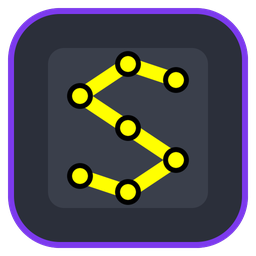
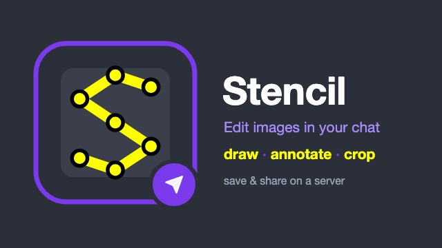
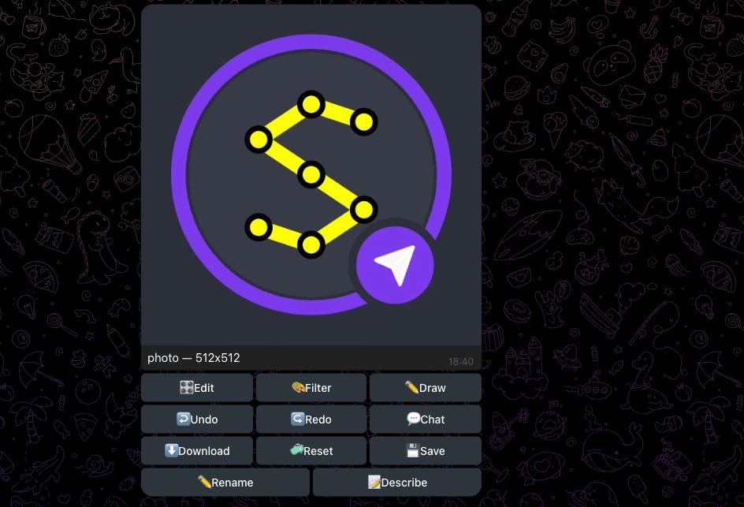

<p align="center">
  <a href="https://github.com/andrew1407/stencil"></a>
</p>
<h1 align="center">Stencil — Telegram bot</h1>
<p align="center">
  Edit pictures from a chat: send a photo, then crop, rotate, filter, draw on it, run a script or ask<br>
  the assistant — and save it to a shared Stencil server. Every edit runs through the Stencil CLI.
</p>
<p align="center">
  <a href="https://hub.docker.com/r/andrew1407/stencil-bot/tags"></a>
  
  <a href="https://github.com/andrew1407/stencil/blob/main/LICENSE"></a>
</p>

<p align="center">
  
</p>

## Quick start

1. Create a bot with [@BotFather](https://t.me/BotFather) and copy its token.
2. Find your Telegram user id: send `/start` to the running bot, it tells you.
3. Run it:

```sh
docker run -d --name stencil-bot \
  -e TELEGRAM_BOT_TOKEN=123456:ABC... \
  -e STENCIL_BOT_ALLOWED_USERS=111111111 \
  -v stencil-bot-data:/data \
  andrew1407/stencil-bot
```

The allowlist **fails closed**: with `STENCIL_BOT_ALLOWED_USERS` empty the bot answers nobody, since
every command costs the operator a fetch, a CLI run or a model call.

<p align="center">
  
</p>

## In the chat

- **Sources** — a photo, an image file or link, a video frame, a blank page, a layout JSON, a
  `.stencil` project or a `.stc` script; a caption applies its command at once.
- **Edits** — crop, rotate, flip, filter, undo, reset, each with a button; download the result,
  the layout or the whole project.
- **Drawing** — lines, rectangles and polygons with your own pen.
- **Assistant** — `/prompt make it sepia and crop 10%`, or `/chat` to keep talking.
- **Servers** — connect, list, fetch, create and save shared projects, and `/sync` with a peer.

## Environment

| Variable | Meaning |
|---|---|
| `TELEGRAM_BOT_TOKEN` | the bot's token — **required** |
| `STENCIL_BOT_ALLOWED_USERS` | comma-separated user ids allowed in — **required** |
| `REDIS_URL` | keep sessions in Redis instead of memory |
| `STENCIL_BOT_DATA_DIR` | working images (`/data` in the image; mount a volume to keep them) |
| `STENCIL_BOT_BROWSER_URL` | the public browser app the bot's links open |
| `STENCIL_LLM_PROVIDER`, `STENCIL_LLM_BASE_URL`, `STENCIL_LLM_MODEL`, `STENCIL_LLM_API_KEY` | the assistant's model (`ollama`, `openai-compat`, `stencil-server`) |

Every option is in the
[bot guide](https://github.com/andrew1407/stencil/blob/main/bot/README.md#configuration).

## Third-party software

Video frames come from a minimal static build of [FFmpeg](https://ffmpeg.org) 9.0.2
(LGPL-2.1-or-later), with [dav1d](https://code.videolan.org/videolan/dav1d) 1.5.4 (BSD-2-Clause) for
AV1, holding only the formats Stencil reads. Their licences, the exact unmodified sources and the build
flags are in the image under `/usr/share/licenses`; the build script is
[`common/docker/buildFfmpeg.sh`](https://github.com/andrew1407/stencil/blob/main/common/docker/buildFfmpeg.sh).

## Tags

| Tag | |
|---|---|
| `1.0.0` | this release |
| `latest` | the newest release |

Every tag is built for **linux/amd64** and **linux/arm64**; `ffmpeg` is included for video frames.

## More

- Source and docs — [github.com/andrew1407/stencil](https://github.com/andrew1407/stencil) ·
  [bot guide](https://github.com/andrew1407/stencil/blob/main/bot/README.md) ·
  [walkthrough with screenshots](https://github.com/andrew1407/stencil/blob/main/usecases/docs/bot/USECASES.md) ·
  [changelog](https://github.com/andrew1407/stencil/blob/main/bot/CHANGELOG.md)
- The other images — [browser](https://hub.docker.com/r/andrew1407/stencil-browser) ·
  [cli](https://hub.docker.com/r/andrew1407/stencil-cli) ·
  [mcp](https://hub.docker.com/r/andrew1407/stencil-mcp) ·
  [server](https://hub.docker.com/r/andrew1407/stencil-server)
