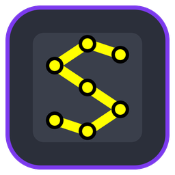
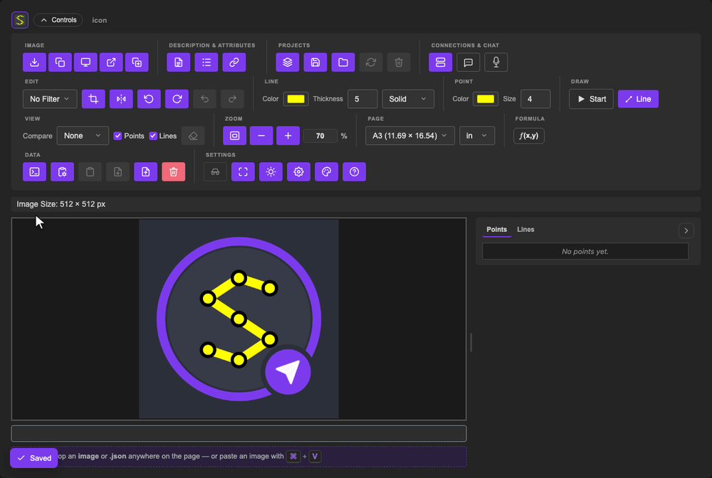

<p align="center">
  <a href="https://github.com/andrew1407/stencil"></a>
</p>
<h1 align="center">Stencil — browser editor</h1>
<p align="center">
  Draw over any picture, measure it in page units, script the edits and share the project —<br>
  the whole editor as a static web app, served by nginx.
</p>
<p align="center">
  <a href="https://hub.docker.com/r/andrew1407/stencil-browser/tags"></a>
  
  <a href="https://github.com/andrew1407/stencil/blob/main/LICENSE"></a>
</p>



## Quick start

```sh
docker run -d --name stencil -p 8080:80 andrew1407/stencil-browser
```

Open **http://localhost:8080**. Nothing else to install: the shared C++ core runs in the page as
WebAssembly, and projects are kept in the browser.

## What's inside

- **Draw and measure** — polylines, rectangles and filled areas, with a live pixel ↔ cm readout on
  ISO A/B/C pages or a custom size, and `f(x,y)` formula transforms.
- **Edit the picture** — crop, flip, rotate, zoom, compare before/after, undo, and B&W, sepia,
  invert, contour or tint filters; video frames open straight from a clip.
- **Scripts (`.stc`)** — plain-text edit steps, run in place, with errors underlined.
- **Projects (`.stencil`)** — saved in the browser, or as one portable file every Stencil app opens.
- **Collaboration** — connect to a [Stencil server](https://hub.docker.com/r/andrew1407/stencil-server)
  and co-edit shared projects live.
- **AI assistant** — describe an edit in words and get a checked plan of real toolbar edits; you
  bring the model (Ollama, any OpenAI-compatible server, Anthropic, or a Stencil server's proxy).
- **Launch links** — `?source=<image url>`, `?blank=red&width=800&height=600`, `?project=<name>`,
  `?incognito`, `?theme=dark` … open the editor on exactly what you want.
- **Installable** — a PWA that works offline once loaded (install needs HTTPS or `localhost`).

## Serving it

| | |
|---|---|
| Port | `80` (nginx) |
| Content | the static app; no server-side state, no volumes |
| Caching | every file revalidates on each load, so a new image is live at once; an installed app offers the new build with a "click to reload" notice |
| Security | ships its Content-Security-Policy header |

The app is hundreds of small ES modules, so in production put it behind a TLS terminator that speaks
HTTP/2 — over plain HTTP/1.1 the modules queue on six connections.

## Tags

| Tag | |
|---|---|
| `1.0.0` | this release |
| `latest` | the newest release |

Every tag is built for **linux/amd64** and **linux/arm64**.

## More

- Source and docs — [github.com/andrew1407/stencil](https://github.com/andrew1407/stencil) ·
  [browser guide](https://github.com/andrew1407/stencil/blob/main/browser/README.md) ·
  [walkthrough with screenshots](https://github.com/andrew1407/stencil/blob/main/usecases/docs/browser/USECASES.md) ·
  [changelog](https://github.com/andrew1407/stencil/blob/main/browser/CHANGELOG.md)
- The published app — [andrew1407.github.io/stencil](https://andrew1407.github.io/stencil/)
- The other images — [cli](https://hub.docker.com/r/andrew1407/stencil-cli) ·
  [mcp](https://hub.docker.com/r/andrew1407/stencil-mcp) ·
  [server](https://hub.docker.com/r/andrew1407/stencil-server) ·
  [bot](https://hub.docker.com/r/andrew1407/stencil-bot)
