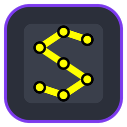
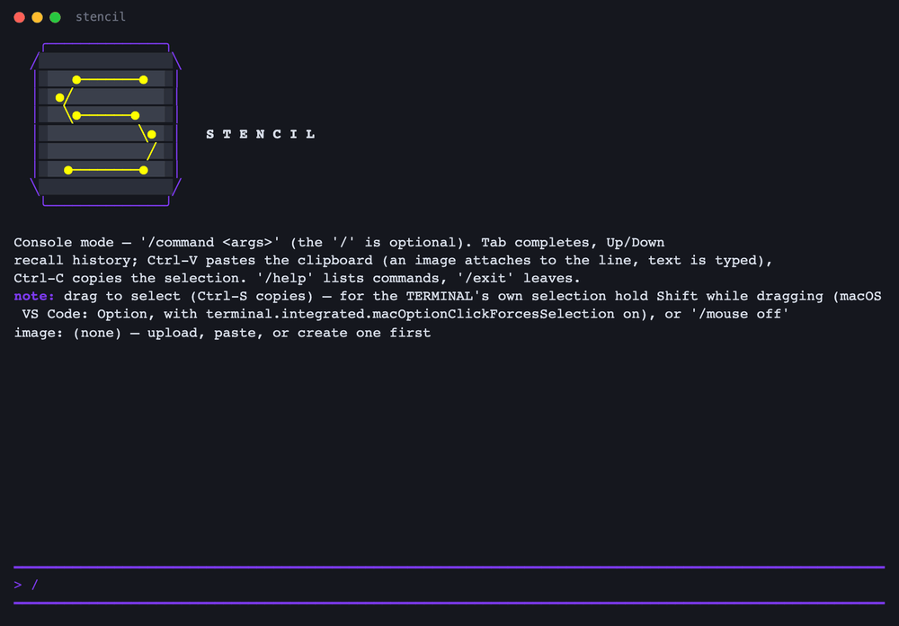

<p align="center">
  <a href="https://github.com/andrew1407/stencil"></a>
</p>
<h1 align="center">Stencil — CLI</h1>
<p align="center">
  Headless image editing from the terminal: crop, rotate, filter, draw a layout, grab a video frame,<br>
  run <code>.stc</code> scripts over whole folders — the same C++ core as every Stencil editor.
</p>
<p align="center">
  <a href="https://hub.docker.com/r/andrew1407/stencil-cli/tags"></a>
  
  <a href="https://github.com/andrew1407/stencil/blob/main/LICENSE"></a>
</p>



## Quick start

The image's entrypoint is `stencil`. Mount the folder you work in and run from it:

```sh
docker run --rm -v "$PWD:/work" -w /work andrew1407/stencil-cli \
  -i photo.jpg -c "x1=10% x2=90% y1=10% y2=90%" -r 1 --filter sepia out.png
```

```sh
alias stencil='docker run --rm -v "$PWD:/work" -w /work andrew1407/stencil-cli'

stencil --blank b5 pink page.png                  # a blank ISO page
stencil -i clip.mp4 -f 24 frame.png               # a video frame (ffmpeg is in the image)
stencil --script shots.stc                        # a .stc script; its @source can name a folder
stencil -i https://example.com/pic.png --probe    # size, format and alpha, read from the header
stencil --help
```

The interactive console needs a terminal: `docker run --rm -it -v "$PWD:/work" -w /work
andrew1407/stencil-cli --console` (or `--console-full-screen`).

## What it does

- **One-shot edits** — a file, an `http(s)` URL, a video frame or a blank page in; crop in `px`,
  `cm`, `mm`, `in` or `%`, flip, rotate, draw a layout, filter, thumbnail; PNG, JPEG, BMP, TGA or a
  `.stencil` project out.
- **Scripts** — `--script`, `--script-check`, `--script-plan`, and `--script-emit` to rewrite a
  `.stc` as JavaScript or Python.
- **Scraping** — `--source-site <url>` downloads a page's images and videos, filtered by kind,
  format, name and size.
- **Servers** — fetch, edit and publish projects on a
  [Stencil server](https://hub.docker.com/r/andrew1407/stencil-server).
- **AI assistant** — `--prompt "make it sepia and crop 10%"` with the model set by `STENCIL_LLM_*`.

## Environment

| Variable | Meaning |
|---|---|
| `STENCIL_LLM_PROVIDER`, `STENCIL_LLM_BASE_URL`, `STENCIL_LLM_MODEL`, `STENCIL_LLM_API_KEY` | the assistant's model (`ollama`, `openai-compat`, `anthropic`, `stencil-server`) |
| `STENCIL_SERVER_TOKENS` | `origin=token` pairs for collaboration servers, instead of `--token` |
| `STENCIL_FETCH_STRICT=1` | refuse loopback on every fetch |

Inside a container, `localhost` is the container: point a local model at `host.docker.internal`.

## Third-party software

Video frames come from a minimal static build of [FFmpeg](https://ffmpeg.org) 9.0.2
(LGPL-2.1-or-later), with [dav1d](https://code.videolan.org/videolan/dav1d) 1.5.4 (BSD-2-Clause) for
AV1, holding only the formats Stencil reads. Their licences, the exact unmodified sources and the build
flags are in the image under `/usr/share/licenses`; the build script is
[`common/docker/buildFfmpeg.sh`](https://github.com/andrew1407/stencil/blob/main/common/docker/buildFfmpeg.sh).

## Tags

| Tag | |
|---|---|
| `1.0.0` | this release |
| `latest` | the newest release |

Every tag is built for **linux/amd64** and **linux/arm64**. Static binaries for macOS, Windows and
Linux are on the [GitHub release](https://github.com/andrew1407/stencil/releases/latest).

## More

- Source and docs — [github.com/andrew1407/stencil](https://github.com/andrew1407/stencil) ·
  [CLI guide](https://github.com/andrew1407/stencil/blob/main/cli/README.md) ·
  [walkthrough](https://github.com/andrew1407/stencil/blob/main/usecases/docs/cli/USECASES.md) ·
  [the `.stc` language](https://github.com/andrew1407/stencil/blob/main/contracts/stc/stc-contract.md) ·
  [changelog](https://github.com/andrew1407/stencil/blob/main/cli/CHANGELOG.md)
- The other images — [browser](https://hub.docker.com/r/andrew1407/stencil-browser) ·
  [mcp](https://hub.docker.com/r/andrew1407/stencil-mcp) ·
  [server](https://hub.docker.com/r/andrew1407/stencil-server) ·
  [bot](https://hub.docker.com/r/andrew1407/stencil-bot)
