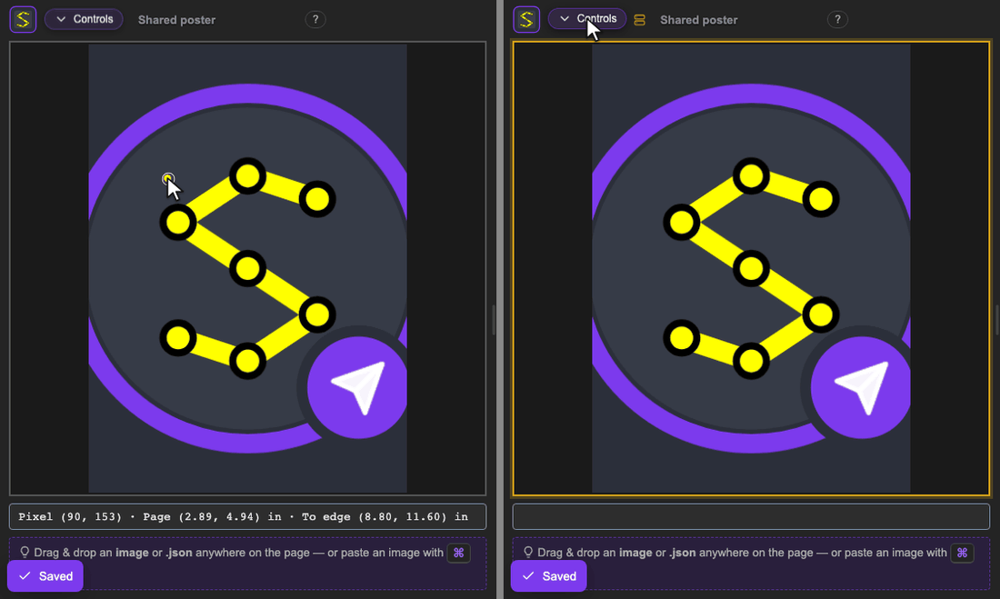

<p align="center">
  <a href="https://github.com/andrew1407/stencil"></a>
</p>
<h1 align="center">Stencil — collaboration server</h1>
<p align="center">
  Shared Stencil projects for every editor: stored over REST under a version guard, with every change<br>
  announced live over WebSocket and TCP. Postgres for metadata, a confined file store for images.
</p>
<p align="center">
  <a href="https://hub.docker.com/r/andrew1407/stencil-server/tags"></a>
  
  <a href="https://github.com/andrew1407/stencil/blob/main/LICENSE"></a>
</p>



## Quick start

With Postgres beside it (`compose.yaml`):

```yaml
services:
  db:
    image: postgres:18-alpine
    environment: { POSTGRES_USER: stencil, POSTGRES_PASSWORD: stencil, POSTGRES_DB: stencil }
    volumes: [pgdata:/var/lib/postgresql]
    healthcheck:
      test: ["CMD-SHELL", "pg_isready -U stencil -d stencil"]
      interval: 5s
      retries: 10
  filestore-init:   # the server runs as UID 65532; hand it the volume once
    image: alpine:3.24
    command: ["chown", "-R", "65532:65532", "/data/filestore"]
    volumes: [filestore:/data/filestore]
  server:
    image: andrew1407/stencil-server
    restart: unless-stopped
    depends_on:
      db: { condition: service_healthy }
      filestore-init: { condition: service_completed_successfully }
    environment:
      DATABASE_URL: postgres://stencil:stencil@db:5432/stencil?sslmode=disable
      ADMIN_TOKEN: change-me-to-a-long-random-secret
    volumes: [filestore:/data/filestore]
    ports: ["8090:8090", "8091:8091"]
volumes: { pgdata: {}, filestore: {} }
```

```sh
docker compose up -d
curl http://localhost:8090/healthz
```

Connect from any editor with `http://localhost:8090` and a token minted with the admin token. The
schema is created at boot; Redis is optional (`REDIS_URL`) and only needed to run several instances.

## Ports and storage

| | |
|---|---|
| `8090` | REST, WebSocket feed (`/ws`) and `/healthz` |
| `8091` | the raw-TCP event feed the desktop app and the CLI use |
| `/data/filestore` | image bytes (`FILESTORE_ROOT`); owned by UID **65532**, the image's non-root user |

## Configuration

| Variable | Meaning |
|---|---|
| `DATABASE_URL` | Postgres connection string — **required** |
| `ADMIN_TOKEN` | gates token issuance; unset, a random one is printed at boot. Set it for anything beyond localhost |
| `CORS_ORIGINS` | the browser origins allowed in (loopback only by default) |
| `REDIS_URL` | cross-instance fan-out; empty runs single-instance |
| `TLS_CERT`, `TLS_KEY` | one certificate secures HTTPS, WSS and the TCP feed |
| `TOKEN_TTL_HOURS`, `PROJECT_TTL_HOURS` | session and project lifetimes |
| `STORAGE_QUOTA_BYTES`, `STORAGE_QUOTA_PER_OWNER_BYTES`, `STORAGE_QUOTA_PER_SESSION_BYTES` | storage caps (`0` = unlimited) |
| `LLM_PROVIDER`, `LLM_API_KEY`, `LLM_MODEL` | an assistant proxy that keeps the key on the server |
| `TRUSTED_PROXY_CIDRS` | networks whose `X-Forwarded-For` is trusted |

Every key is described in the
[sample env file](https://github.com/andrew1407/stencil/blob/main/server/.env.example).

## Tags

| Tag | |
|---|---|
| `1.0.0` | this release |
| `latest` | the newest release |

Every tag is built for **linux/amd64** and **linux/arm64**, on a distroless, non-root base.

## More

- Source and docs — [github.com/andrew1407/stencil](https://github.com/andrew1407/stencil) ·
  [server guide](https://github.com/andrew1407/stencil/blob/main/server/README.md) (REST API, events
  feed, security) · [changelog](https://github.com/andrew1407/stencil/blob/main/server/CHANGELOG.md)
- The other images — [browser](https://hub.docker.com/r/andrew1407/stencil-browser) ·
  [cli](https://hub.docker.com/r/andrew1407/stencil-cli) ·
  [mcp](https://hub.docker.com/r/andrew1407/stencil-mcp) ·
  [bot](https://hub.docker.com/r/andrew1407/stencil-bot)
