# Chrome extension — use cases

The image picker on a real page. Install it from
[`browser-extension/README.md`](../../../browser-extension/README.md).

## A page with pictures

Any page will do: `` elements, CSS backgrounds and other CSS images, a video's frame and its
poster, and the icons and preview images a page declares in its head all count, in the page's
frames too.

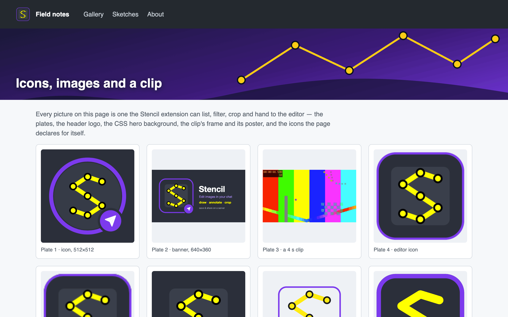

## List every picture on the page

Click the toolbar icon. The popup scans the active tab and lists what it found; each row carries
the picture's name, a badge for its kind — **IMG**, **BG** for a CSS image, **VIDEO** — and for a
**POSTER** or an **ICON** the page declares, then its format and its size. Above the list, each
section folding to its heading, **Elements to include** picks the kinds (**CSS images** counts
backgrounds and every other picture CSS paints), **Formats** and **Size (px)** narrow by file type
and pixel size, and the search box narrows by name or URL, with **.\* Regex** for a pattern. The
header's buttons open the assistant and the side panel, flip the theme, rescan and open the
options.

| Light | Dark |
|---|---|
| 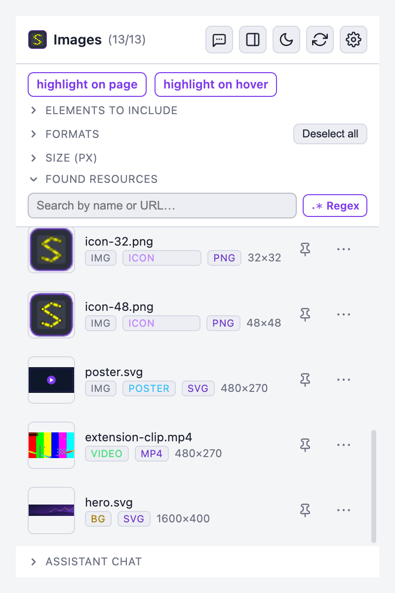 | 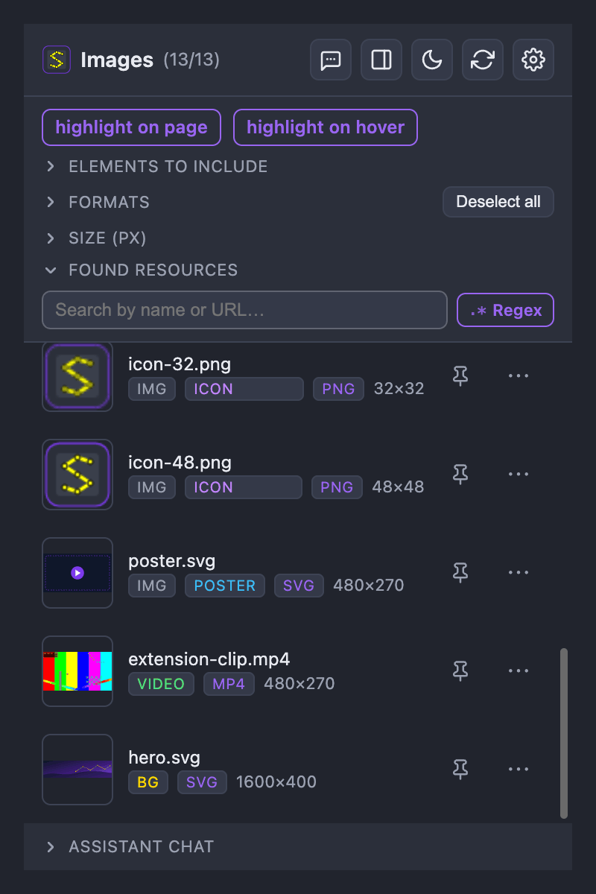 |

## See which element is which

**highlight on page** outlines every image, video and background-image element right on the
page, whatever the filters show; **highlight on hover** outlines the element of the row under
the pointer, which is handiest from the side panel.

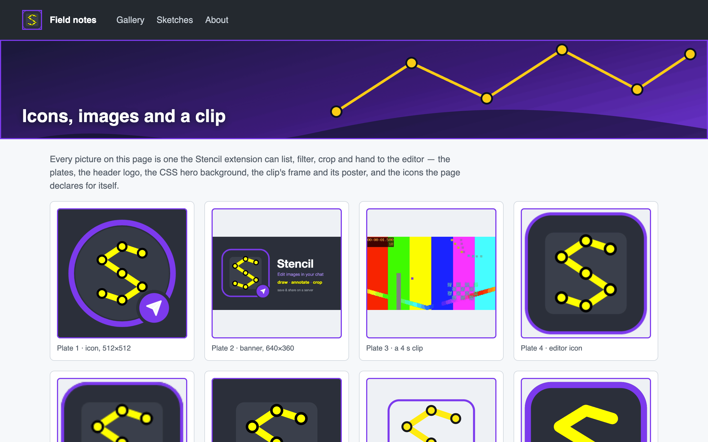

## Open a picture in the editor

Click a row's thumbnail or name to open the picture in a new editor tab; double-click either to
crop it first. The row's **⋯** button — or a right-click anywhere on the row — opens its menu:
**Download**, **Open in new tab**, **Open ›**, **Crop**, **Open in… ›** and **Pin ›**.

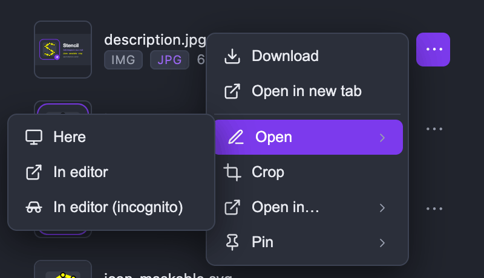

**Open › Here** lays the full editor over the page you are on; the window's title bar can move it to
a tab of its own or close it.

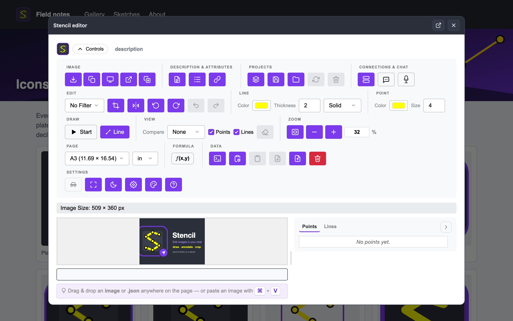

**Open › In editor** opens it in a new editor tab, and **In editor (incognito)** opens one that saves
nothing. **Open in… ›** hands the picture to the desktop app.

| In editor | In editor (incognito) |
|---|---|
| 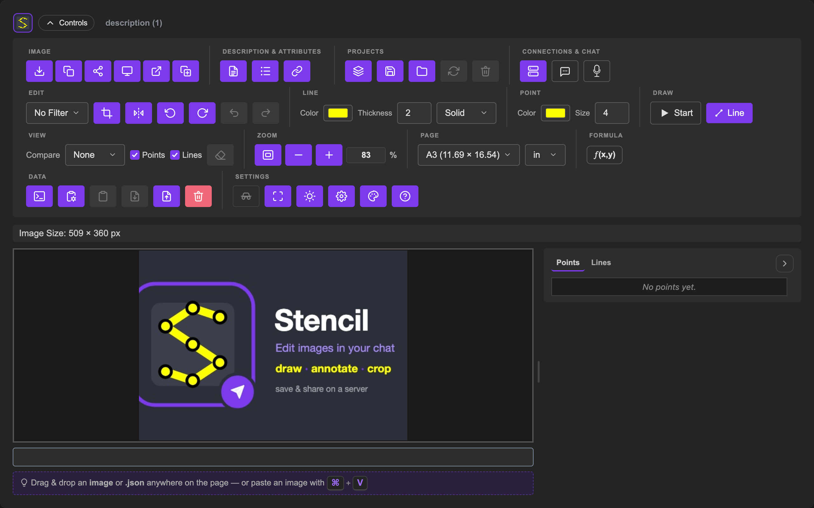 | 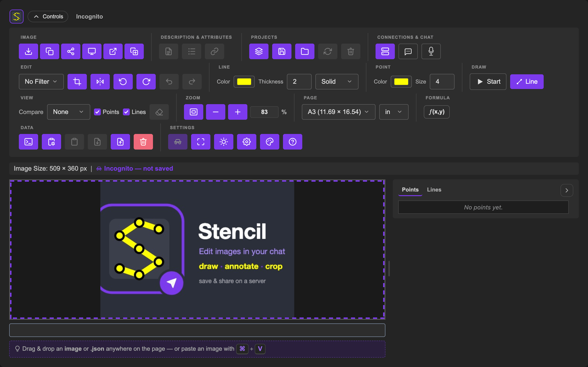 |

A picture you have opened carries an **OPENED** flag, and a click on it asks first: **Resume in open
editor** goes back to that editor's project, **Add as new copy** starts another. **mark opened** and
**opened first** in the filters turn the flag and its place at the top of the list on or off.

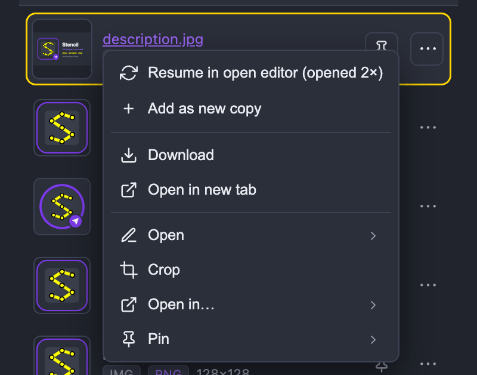

## Videos

A video lists with the frame it is showing. Its menu opens or downloads the video itself, takes
the **Current frame** into the editor or the crop, and does the same for the **Video preview
image** — the poster — which also lists on its own row.

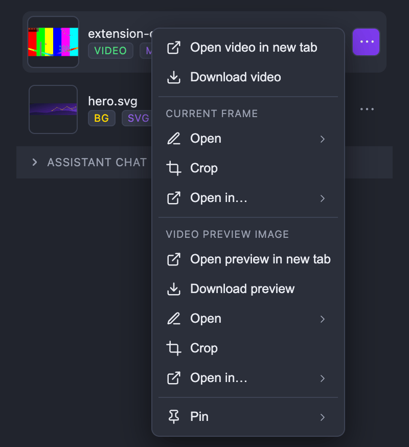

## Right-click on the page

The extension adds a **Stencil** entry to Chrome's own right-click menu. On a picture it holds
**✎ Open in editor ›** (a new tab, the editor already open, incognito, or right here),
**✂ Crop image…**, **🖥 Open in desktop app** and **📌 Pin image**; on a video the same for its
current frame, and its preview image when it has one; on an element painted with a CSS image the
same entry appears for that image. Right-click the toolbar icon for **✎ Open Stencil editor** and
its incognito twin.

## Quick crop before editing

**Crop** frames the picture first, over the page. Drag inside to move the box, a corner to resize
it, scroll to zoom; pick the page size, **Album** or **Portrait**, and turn it with **Left** and
**Right** (`Alt+R`, `Alt+Shift+R`). **When opening in the editor**, **Keep original** opens the whole
picture with this crop applied, still movable, and **Cut cropped part** opens only the framed part
as a new picture; **Open in editor** sends it.

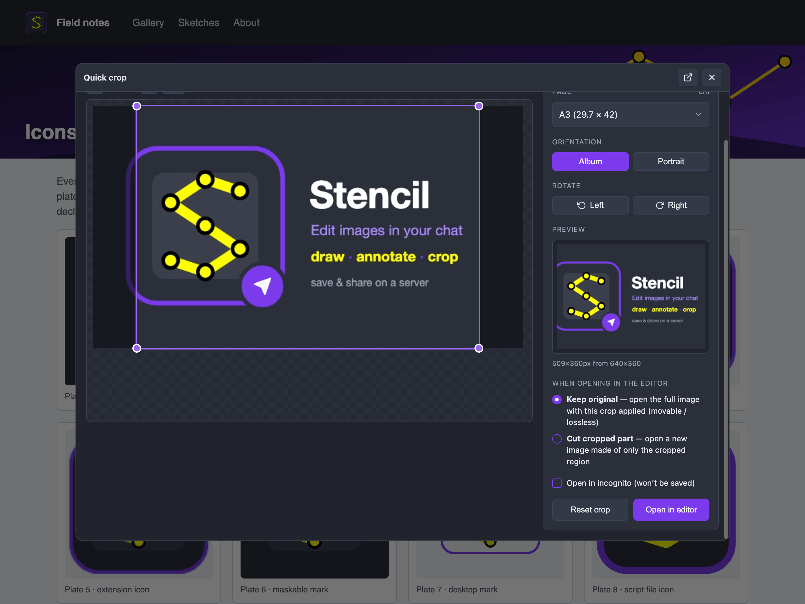

Where a page does not allow a window over it, the crop opens in a tab of its own instead.

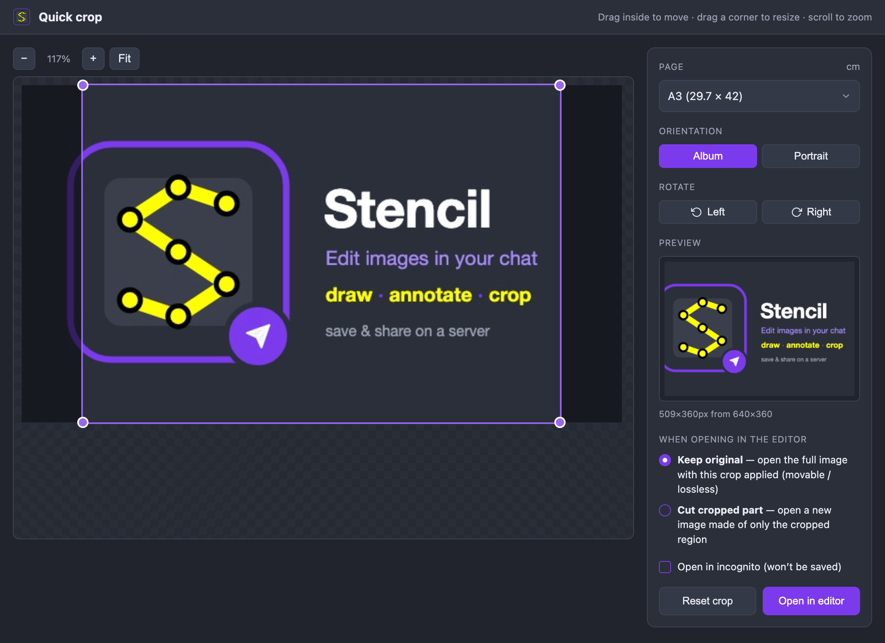

## Keep it docked

The side-panel button in the popup's header moves the same list into Chrome's side panel. It stays
open beside the page and rescans when you switch tabs or a page finishes loading.

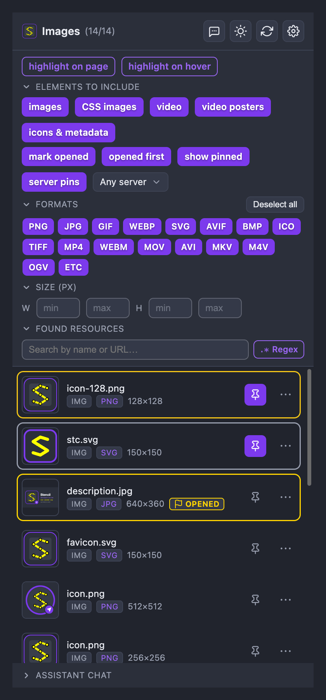

Drag a row out of the side panel onto the page and drop targets cover it — **Open in editor
here**, **Open incognito**, **Open image in new tab** and **Crop** — with the one under the pointer
lit; the drop does it, and `Esc` takes the targets away. The popup closes when the pointer leaves
it, so this works from the side panel only.

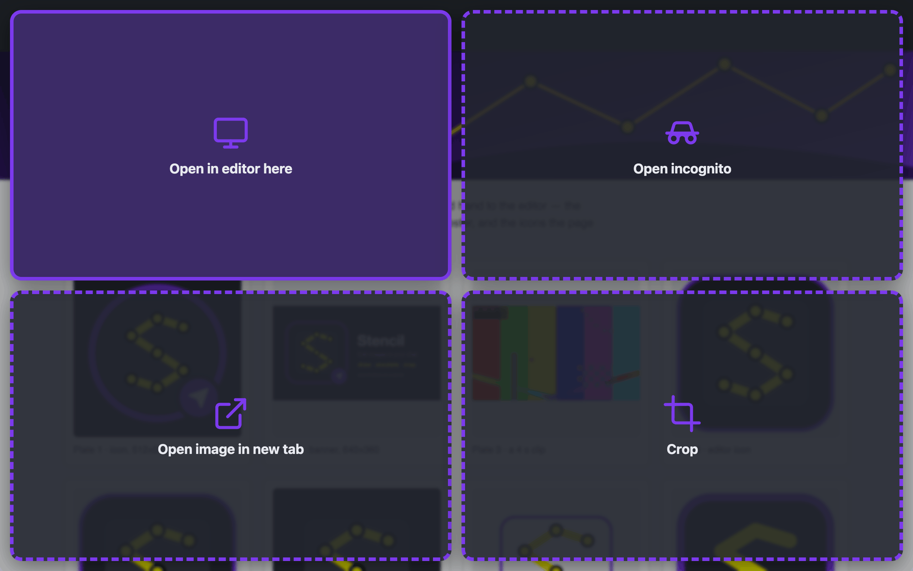

## Pin pictures

The pin on a row keeps a picture at the top of the list. With no server connected it pins at
once; with one, it asks where:

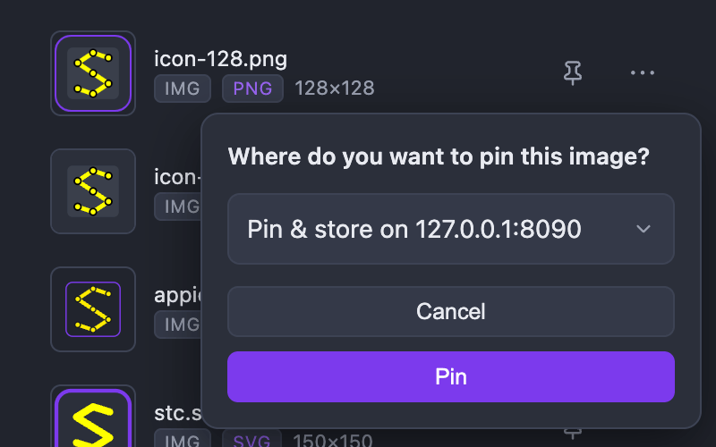

A local pin belongs to the site it was made on: whenever that site's page lists the picture, it
floats up with a grey outline. **Pin & store on** a server also keeps it there as a project: its
row wears a gold outline, and the project is listed at the end of the popup on every page, under
the **server pins** filter.

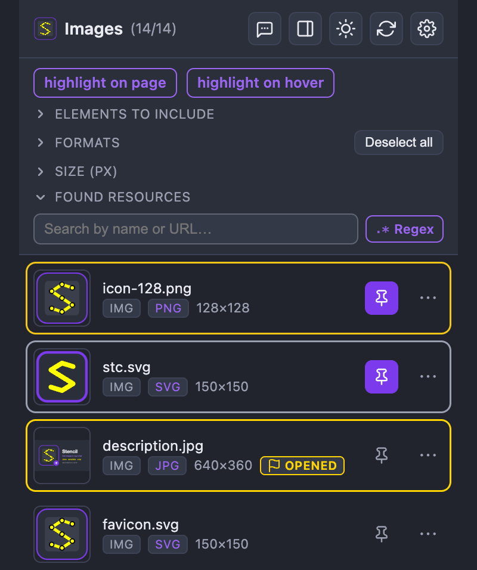

## Ask the assistant

The ✦ button, or the **Assistant chat** section at the bottom, talks to the model set in the
options. It reads the list the scan made: it can answer about the page, point a picture out on it,
open one in the editor, attach pictures for it to look at, pin them, change the filters or rescan
— and, if you allow it, look at your other open tabs.

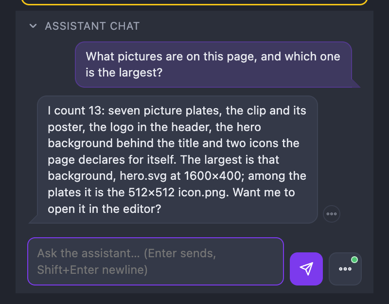

## On an editor tab

Open the popup or the side panel on a Stencil editor tab and it works for that editor: **Open
editors** lists every editor tab, and **Images from another page** lets you tick any open pages and
lists their pictures together. Clicking one brings it into this editor; when the editor already
holds a picture, the list asks whether to **Add as a new project**, **Replace the image** or
**Replace, keep the annotations**.

## In DevTools

DevTools gains a **Stencil** panel: the same list, kept on the tab you are inspecting.

## Options

The first card sets the accent and appearance, the interface motion, the editor's address and
default page size, how opened pictures are marked, the highlight colour, and the hand-offs to the
desktop app and the Telegram bot. Two switches near its end add console scripting: a `window.stencil`
object on every page, and `stencil.extension` on the editor page.

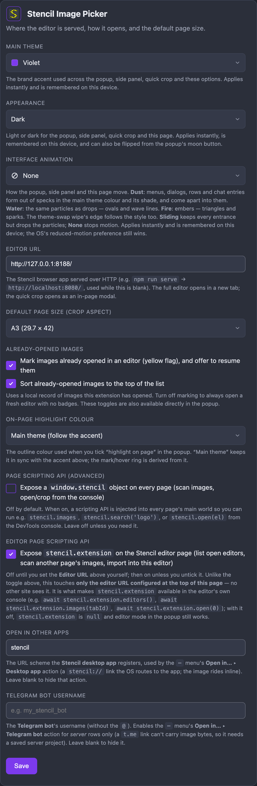

**Server connections** connects to a Stencil collaboration server, with a token or by asking it for
one, and reconnects them later. A connection is what lets a pin, a project or the assistant live
somewhere other than this browser.

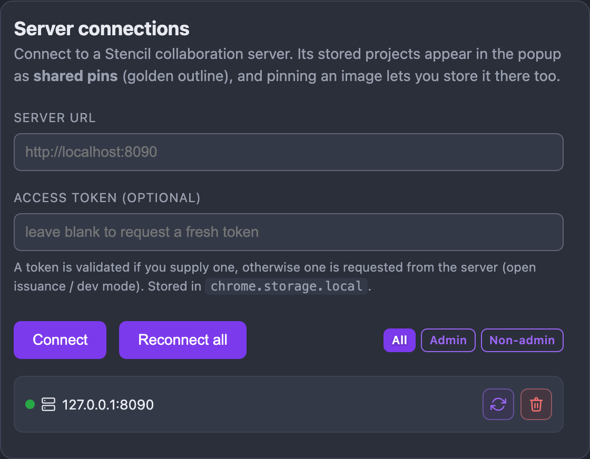

**AI assistant** picks the provider — **Ollama**, an **OpenAI API** server such as LM Studio,
**Anthropic API (Claude)** with your own key, kept only for the session, or a connected **Stencil
collaboration server** — and the model. **None (turned off)** hides the assistant.

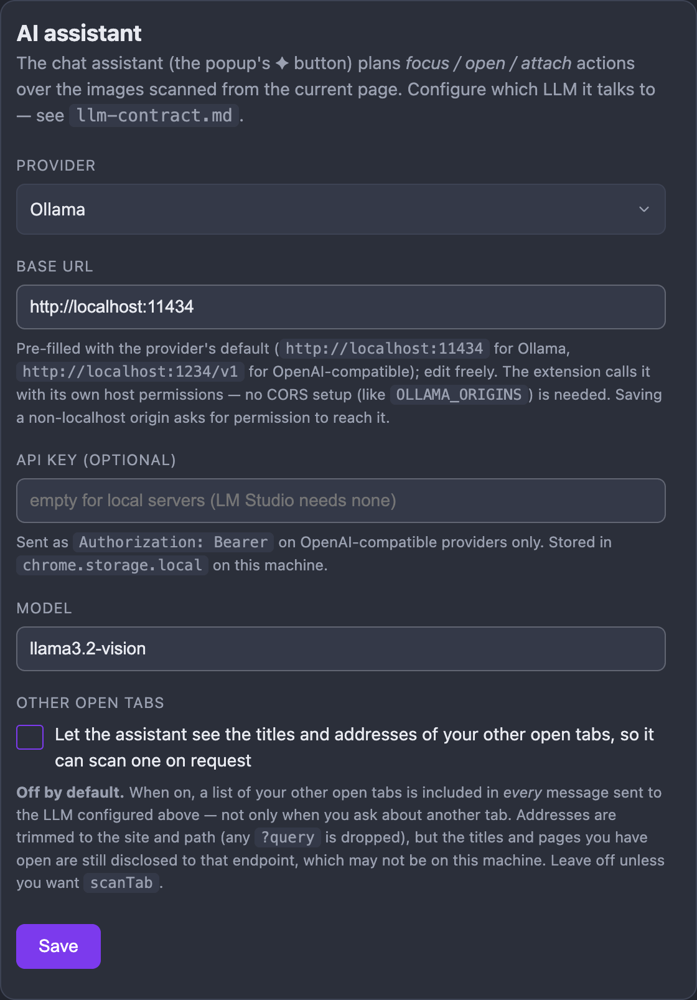

**Pinned images** lists every pin, grouped by the site it was made on — searchable, filtered by
where it is stored, and removable one at a time.

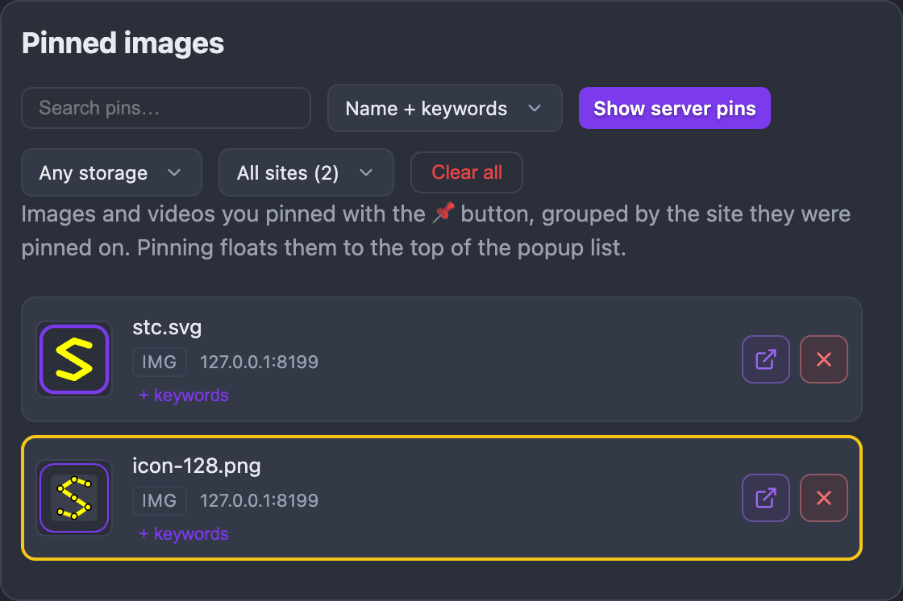
