# CLI — use cases

The Zig command-line tool, one-shot and interactive. Build it from
[`cli/README.md`](../../../cli/README.md).

## One-shot edits

`stencil --help` prints the flags: a source (a file, a URL, a video frame or a blank page), the
edits (crop, flip, rotate, filter, layout, script), and the output path.

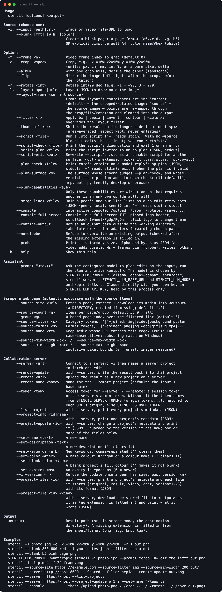

A run reads the source, applies the edits and answers with one line:
`wrote <path> (<width>x<height> px · <page>)`, or `error:` and what went wrong.

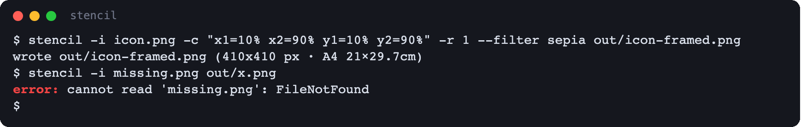

## Edit a folder with a script

A `.stc` script whose `@source` names a folder runs on every picture in it, and a `@save` that
names a folder writes each result there as `<name>-stencil`, in the picture's own format.

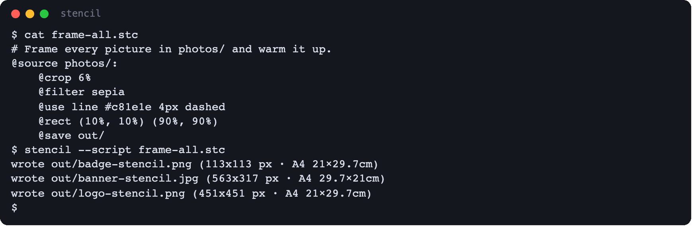

## Draw a layout

`-l` draws a layout JSON — lines with their points, colours, widths and styles — over the
picture. Its points are in the picture's own pixels after the crop and turns; `--layout-frame
source` reads them in the original picture instead.

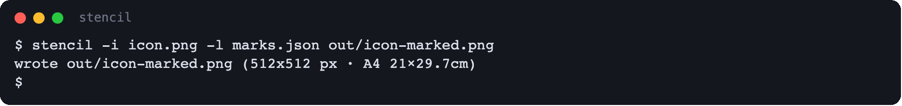

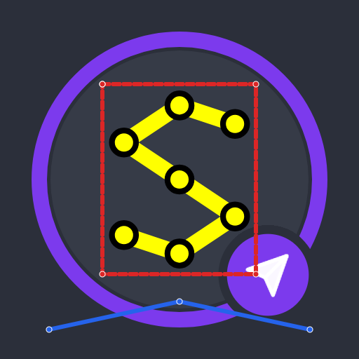

## Take a frame from a video

`--probe` describes a video without writing anything: its format, size, length and frame count.
`-f` picks the frame a run opens; without it, a video opens on its first frame.

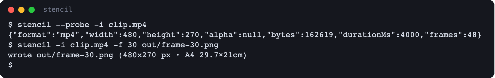

## Share through a server

`--remote <url>` uploads the result as a new project on a collaboration server, named after the
input or by `--remote-name`. `--server <url>` with `-i <project name>` opens a server project
instead, and `--remote-update` writes the result back into it. The token comes from `--token`, or
from the environment: `STENCIL_SERVER_TOKENS` (one per server) or `STENCIL_SERVER_TOKEN`.

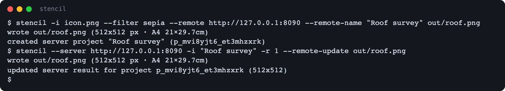

## The full-screen console

`stencil --console-full-screen` opens a console with the logo pinned at the top, the output
under it and the prompt at the bottom; the plain `--console` is the same conversation without
the screen.

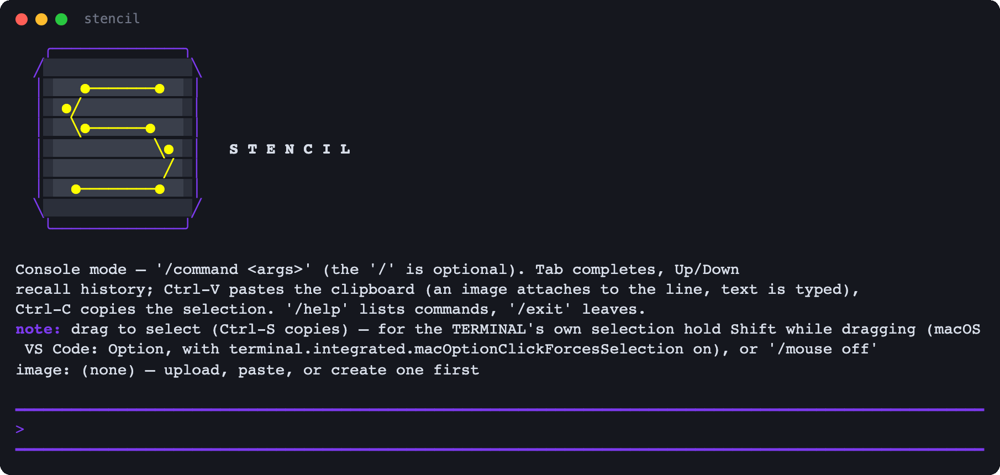

## Load a picture and edit it step by step

`/upload <path|url>` asks `Upload …? (Y/n)` before it loads, and the console then names the
picture; a video opens on its first frame. `/status` describes what is loaded. `/crop`, `/flip`,
`/rotate` and `/filter` take the same arguments as the flags, and every step answers with the
new size and its place in the edit history (`[3/4]`: step 3 of 4). `/undo` steps back, `/redo`
forward, and `/save` writes the result.

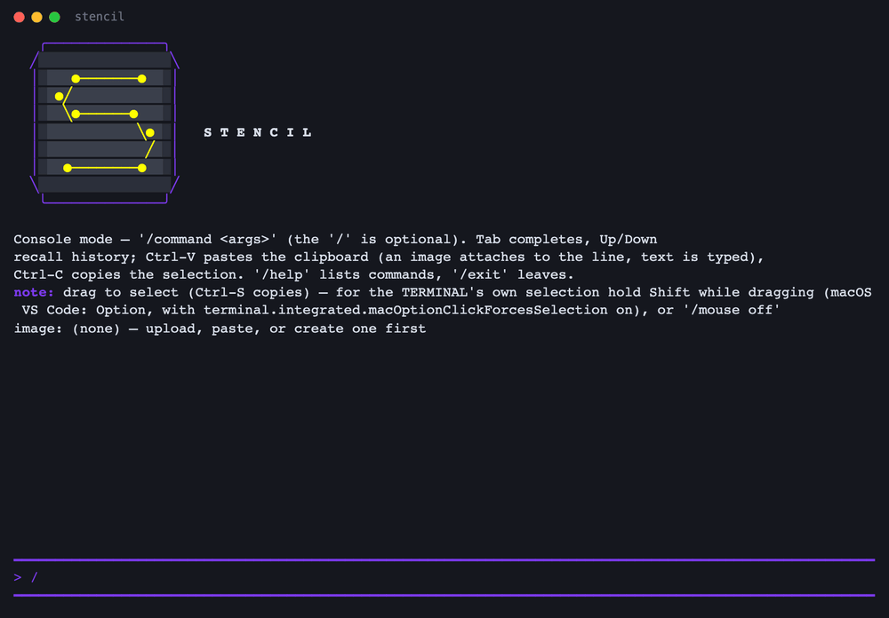

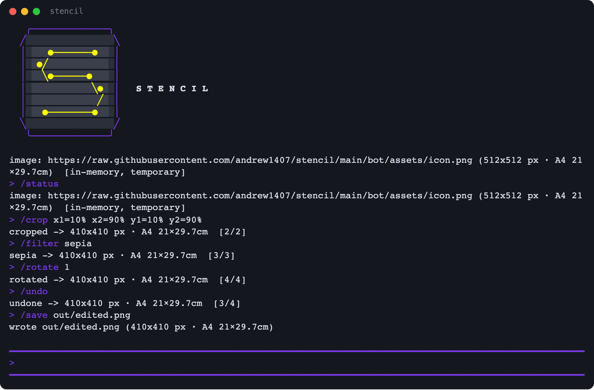

## Start from a blank page and run a script

`/blank a5 black` makes a page. `/script` runs `.stc` statements on the open picture,
`;`-separated, as one edit — so a single `/undo` takes the whole script back.

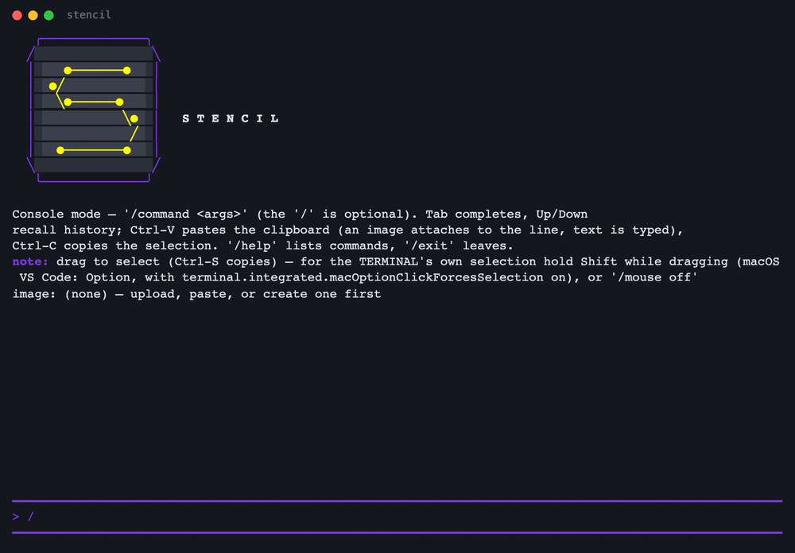

## Ask the assistant

With `STENCIL_LLM_*` pointing at a model, `/prompt` describes an edit in words. The plan runs on
the working picture step by step, and each variant it asks for is written to the working
directory as `variant-<label>.png`.

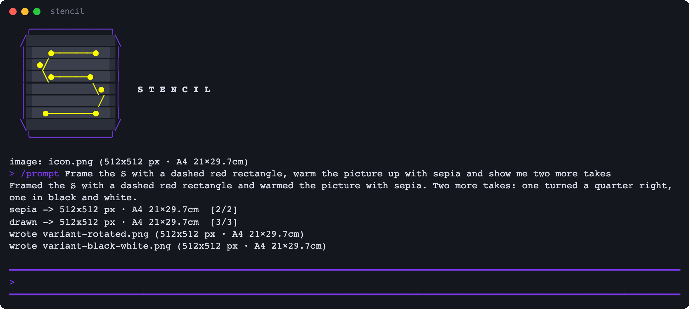

## Hand the picture to the other apps

`/browser` opens the session in the browser app, at its default address unless
`STENCIL_BROWSER_URL` or the command names another. `/desktop` opens it in the desktop app: a
server project by its link, anything else as a `.stencil` file the command writes first.

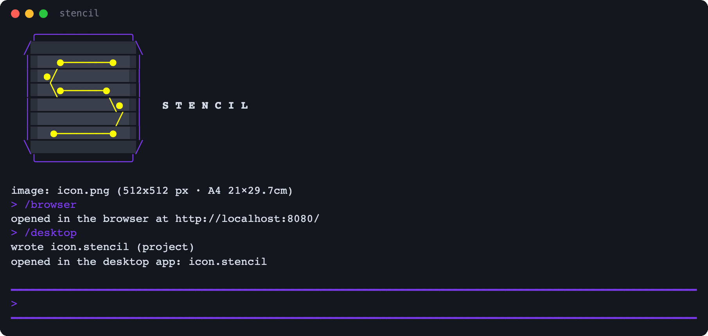

## Every command

`/help` lists the commands, grouped: image, edit, save, connections, apps, assistant and system,
with the keyboard shortcuts under them.

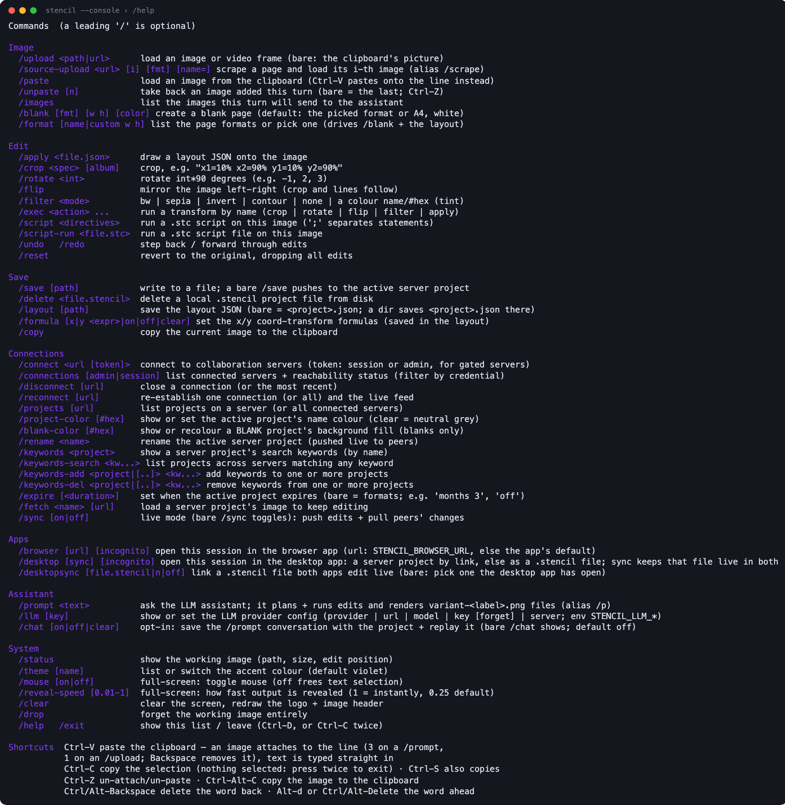

`/format` lists the page formats, and `/theme` the accent colours, each name in its own colour —
the dark ones read best in a light terminal:

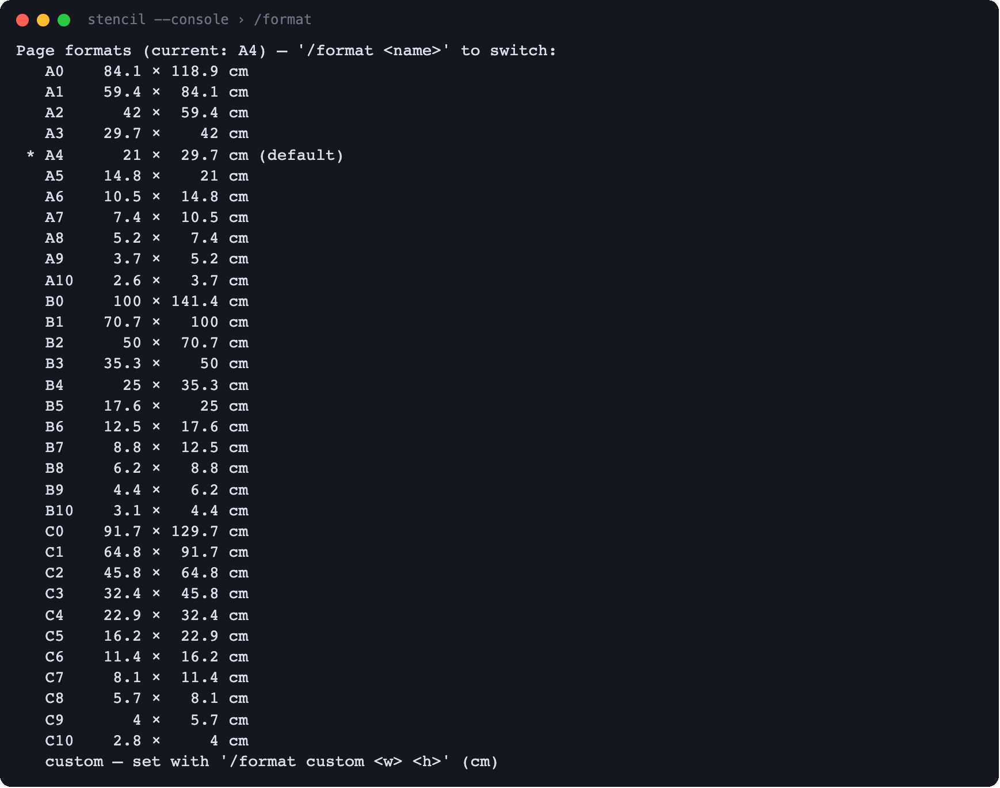

| In a dark terminal | In a light terminal |
|---|---|
| 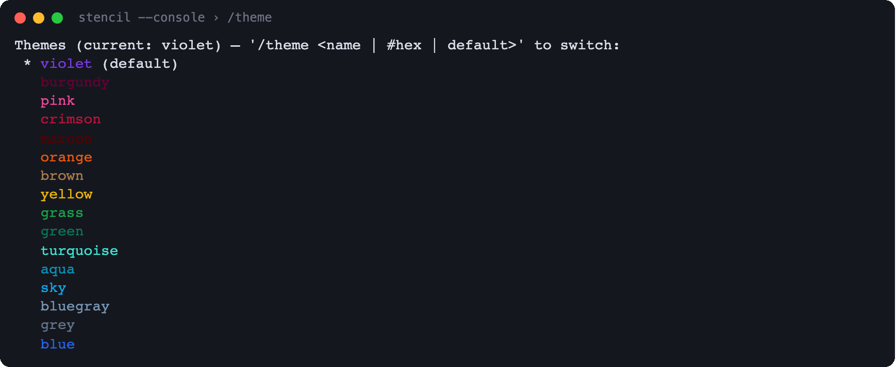 | 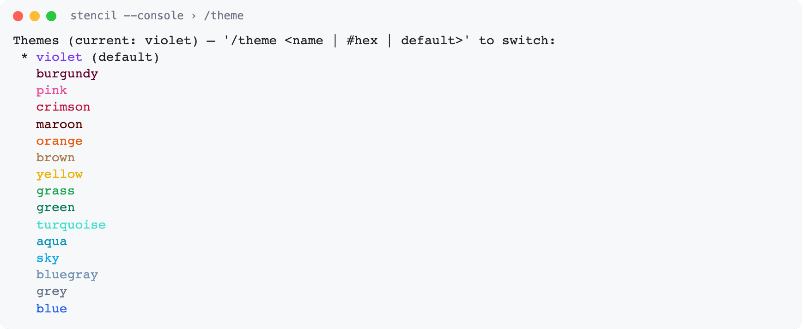 |

`/projects` lists the projects on every connected server; `/connect <url> [token]` adds one.

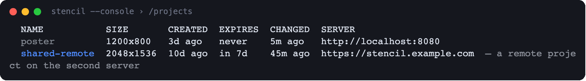

## Change the accent

Click the logo to cycle the accent colour; the recolour sweeps across the header, the edit log
and the prompt.

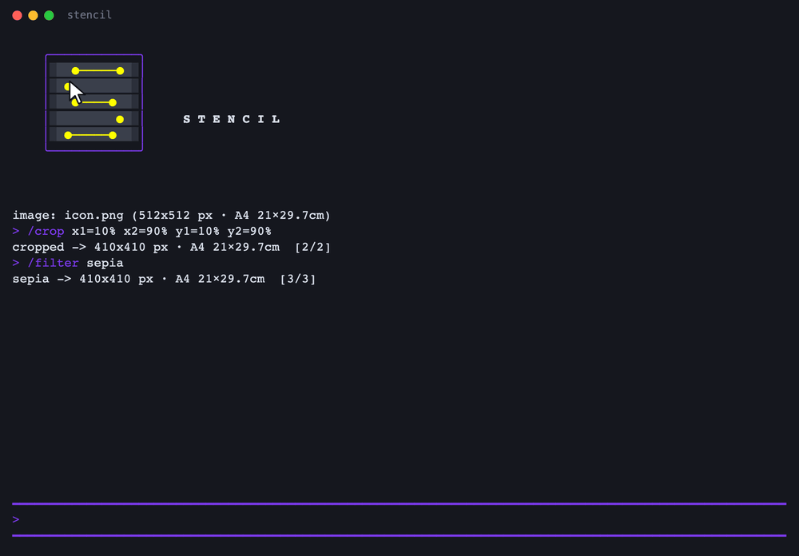

`/theme` takes an accent by name, any CSS colour name, or a `#hex`.

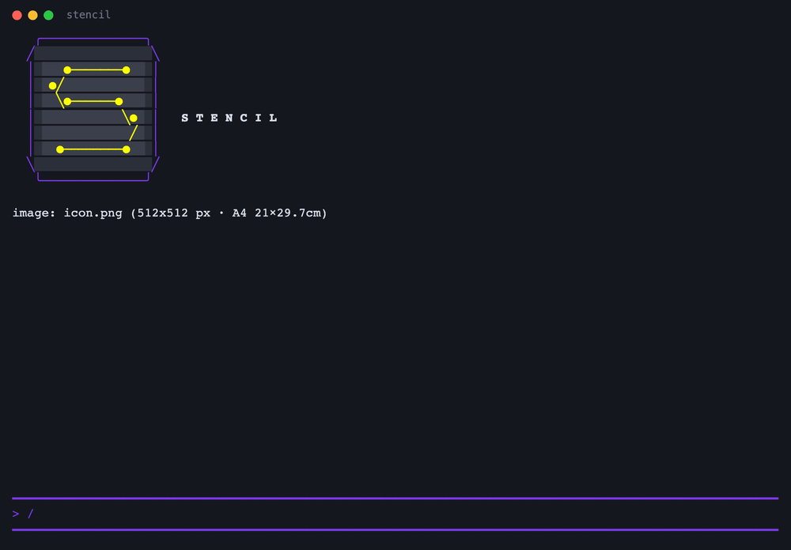

Output reveals line by line; `/reveal-speed` sets the pace, from `0.01` to `1` (instant).

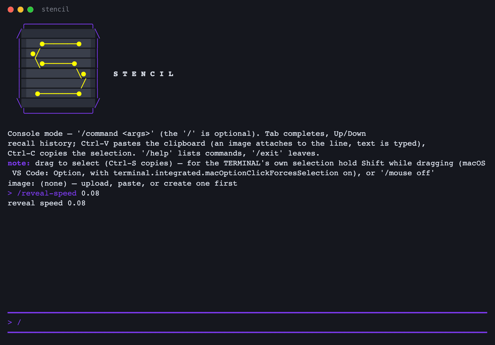
