# Desktop app — use cases

The Qt app, scenario by scenario. Build and run it from
[`desktop/README.md`](../../../desktop/README.md). Keyboard shortcuts are written with Ctrl; on a
Mac they use ⌘ instead.

## Open the app

The window has a header with the logo and the project name, the toolbar sections, the canvas
with its **Blank image** card, and the points table. Where the system keeps a menu bar of its own,
as macOS does, the menus sit there; switch off **Use the system menu bar** in **Visuals &
Settings** to keep them in the window, as in these pictures. Appearance follows the OS;
**View ▸ Dark Theme** (`Ctrl+D`) flips it, and reads **Light Theme** while the dark one is on.

| Light | Dark |
|---|---|
| 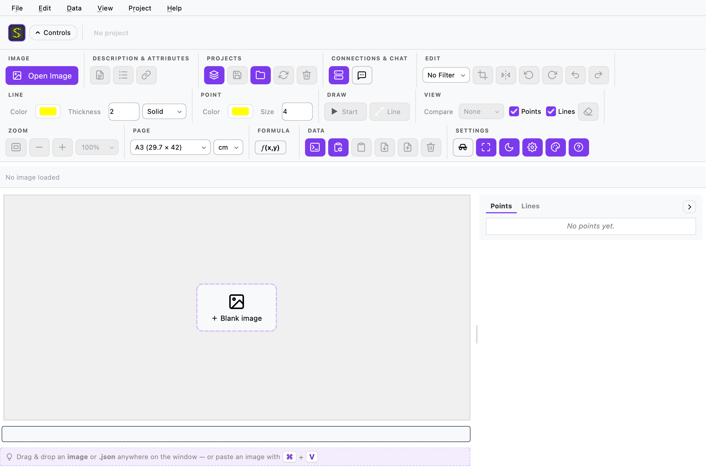 | 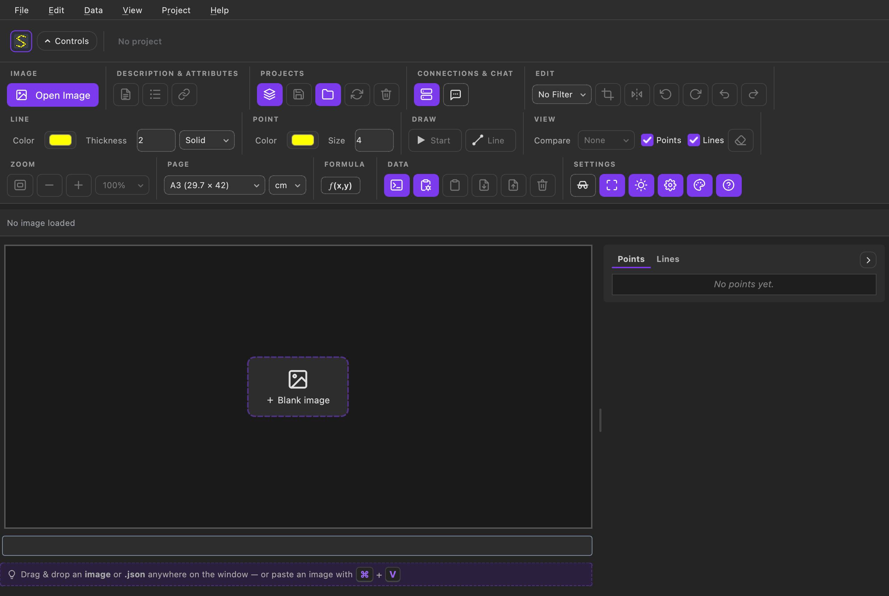 |

## Start from a blank page, a file or a link

**File ▸ Open Image…** (`Ctrl+O`, or the **Blank image** card) has three tabs: **Local file**,
**URL link** and **Blank**. **Blank** takes a fill — **White**, **Black** or any colour from its
swatch — and a **Width** and **Height**, then **Create blank**.

Under **URL link**, paste an `http(s)` address and press **Preview**. **Crop** trims the picture
to the page's shape before it opens, **Incognito** opens it without ever saving it, and **Open
here** or **Open in new window** finishes. Here, a picture straight from the repository:

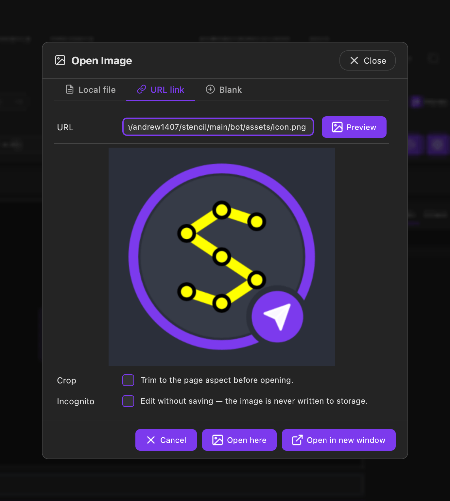

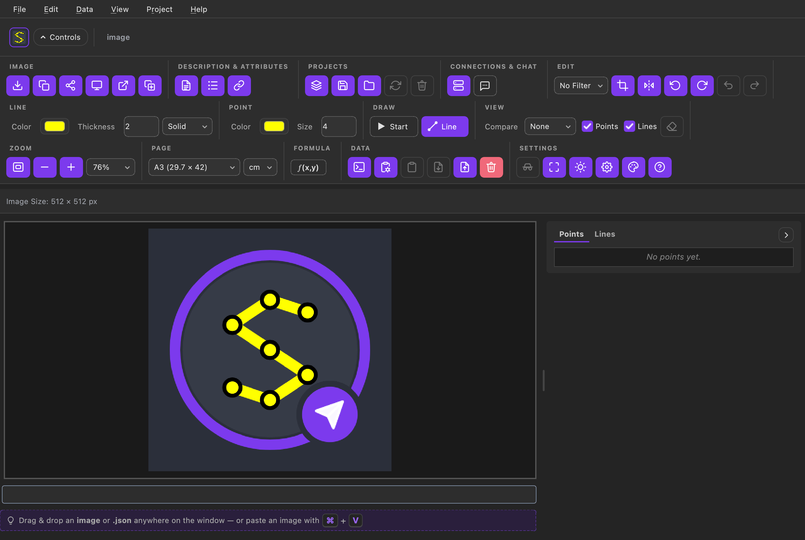

With a picture already open, the dialog also offers **Replace image**: the new picture takes the
old one's place, and **Keep existing annotations** keeps the lines drawn on it. Before a picture is
open, **View ▸ Incognito** (`Alt+I`) makes the editor incognito as well.

From a shell, `stencil --src <path|url>` opens a picture or a video (`--frame <n>` picks the
frame) and `--layout <path|url>` draws a layout over it once it loads.

## Drop a file on the window

Drag an image or a `.stencil` project over the window and it splits in two: drop on the left
to open it and keep it in your projects, on the right to open it **incognito**, without saving
it. The half under the pointer lights up. An image dropped while a picture is open asks whether
it opens in **This window** or a **New window**.

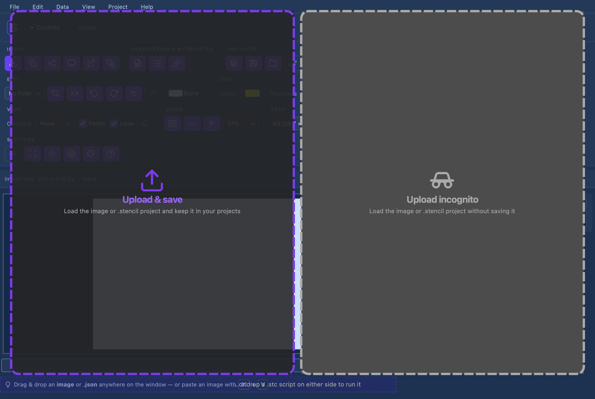

A `.json` layout gets one zone that draws it over the open picture, and a `.stc` script one that
runs it.

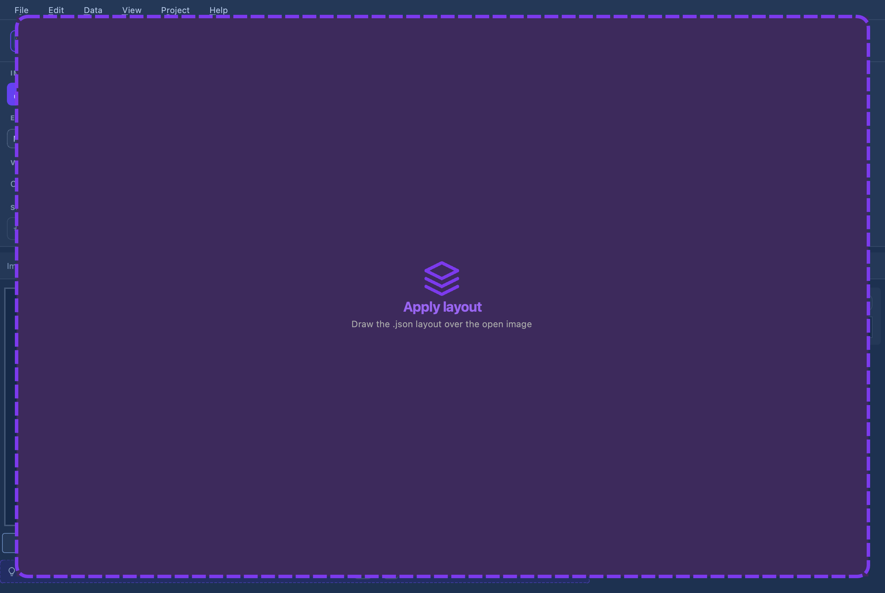

## Open a frame from a video

Choose a video instead — off disk or from a link — and the dialog turns into a small player.
Drag the bar under the picture, or type a **Frame** number, to choose the frame the canvas opens:

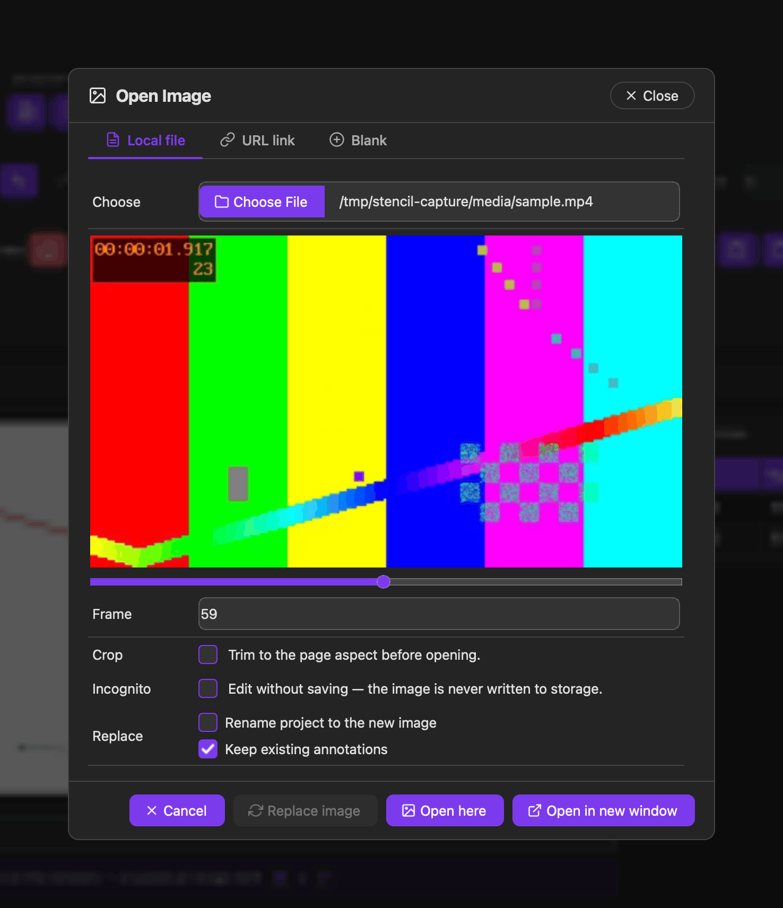

Tick **Crop** and the box is drawn over the player itself, so the frame that lands on the
canvas is the one framed here. The **Album** / **Portrait** button flips the orientation:

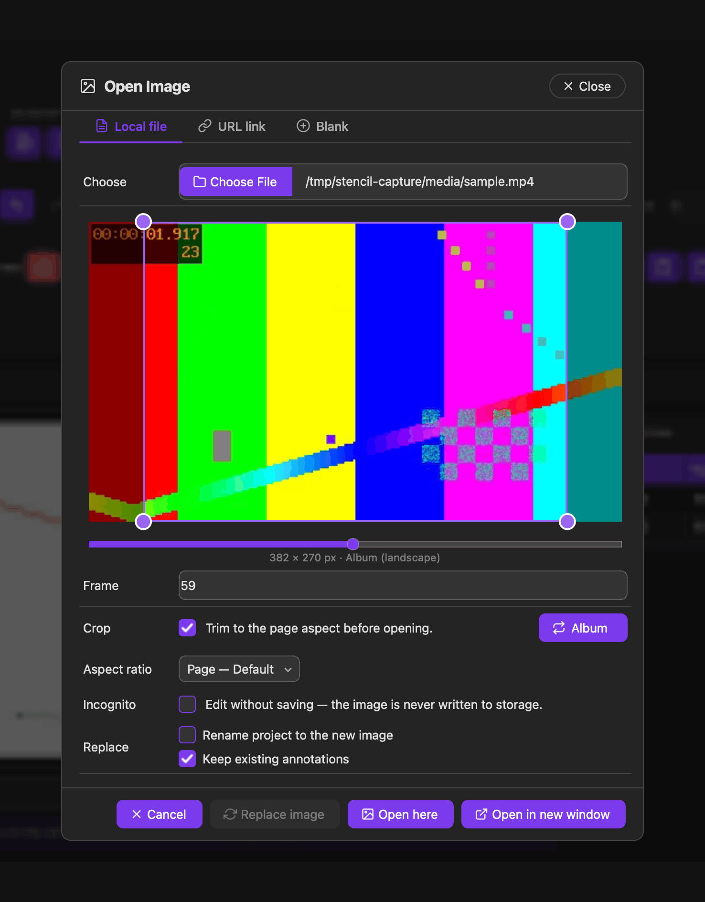

## Draw lines and shapes

**Edit ▸ Start Drawing** (`Alt+A`, or press `~` twice, or **Start** in the **Draw** section)
places a point at each click; the same key stops, and **Edit ▸ New Line** (`Alt+N`) starts the
next line without stopping.

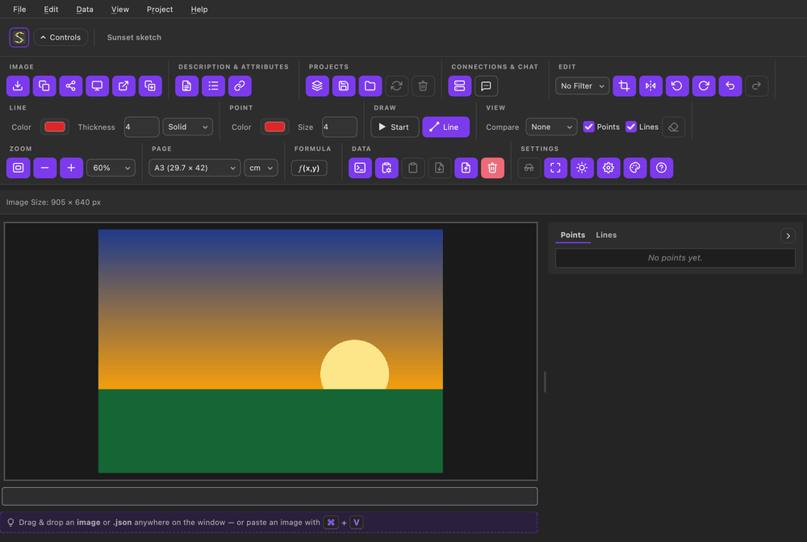

The **Line** button beside **Start** switches to **Rect**: drag across the picture to sweep a
rectangle. Back on **Line**, clicking a line's first point again closes it into an area. A
selected rectangle or area gets **Fill** in the selected-line bar — a colour and its opacity,
0 to 255 — and **Unchain**, which opens it back into a line. **Edit ▸ Draw Line** and **Draw
Rectangle** start either one directly.

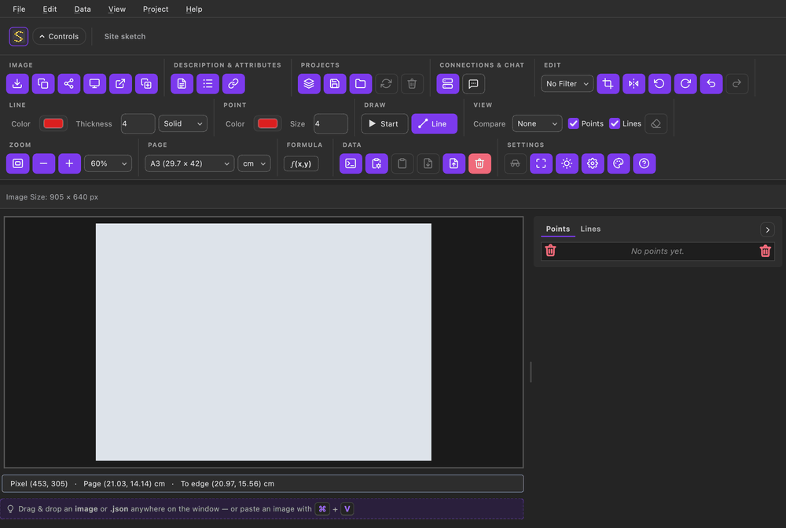

Selecting a line raises the bar above the canvas, where colour, thickness, point size and style
change for that line only. The **Points** tab lists the selected line's points in pixels and in
page units (cm or in), editable in place.

| Light | Dark |
|---|---|
| 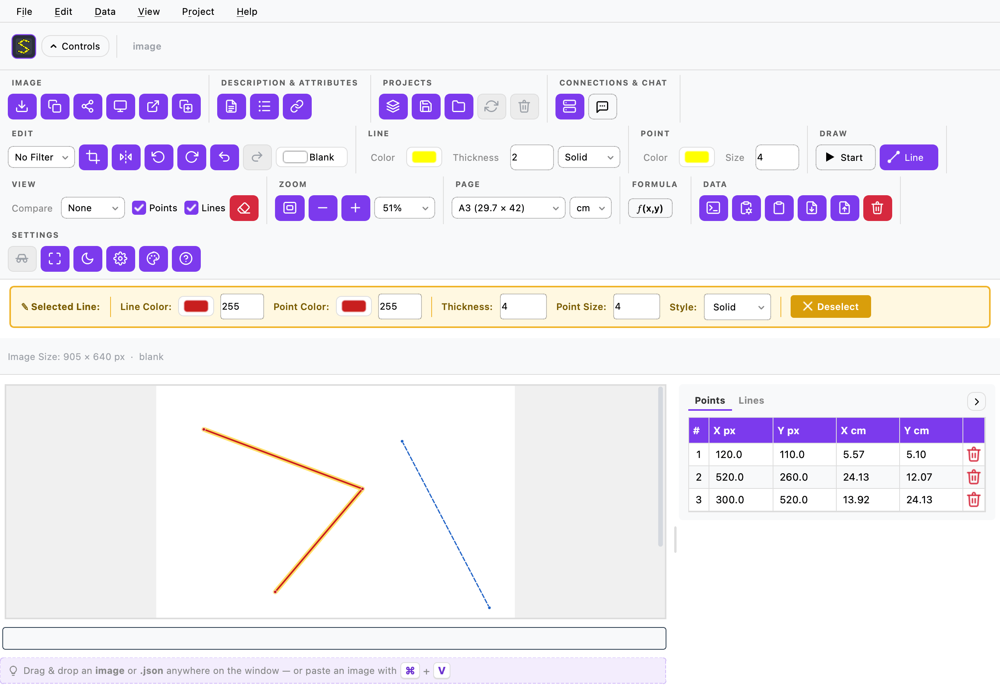 | 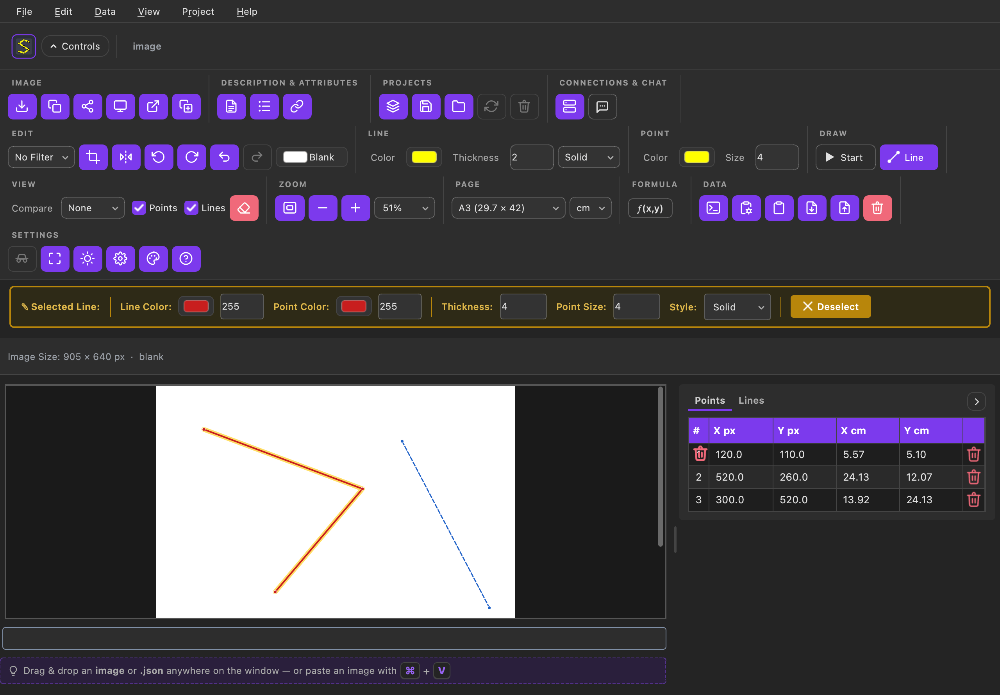 |

The **Lines** tab lists every line with its name and colour. A line is `Line 1`, `Line 2`… until
you name it: double-click the name to type one. The eye hides a line from the canvas, dimming
its row, and shows it again.

Click a line's colour swatch to pick a new colour for it, with the canvas following as you drag;
double-click the swatch to give the line the toolbar's line colour back. Double-clicking any other
colour swatch puts it back to its default — the toolbar's line colour to yellow, its point colour
to the line's, the tint to its default, and each colour in **Visuals & Settings** to its own.

Each row also carries the line's thickness, its points' colour and their size. Double-click a
number to type a new one — Enter keeps it, Escape leaves it as it was — and click the round swatch
to pick the points' colour; double-click it to reset them to the toolbar's point colour. None of
these changes which line is selected.

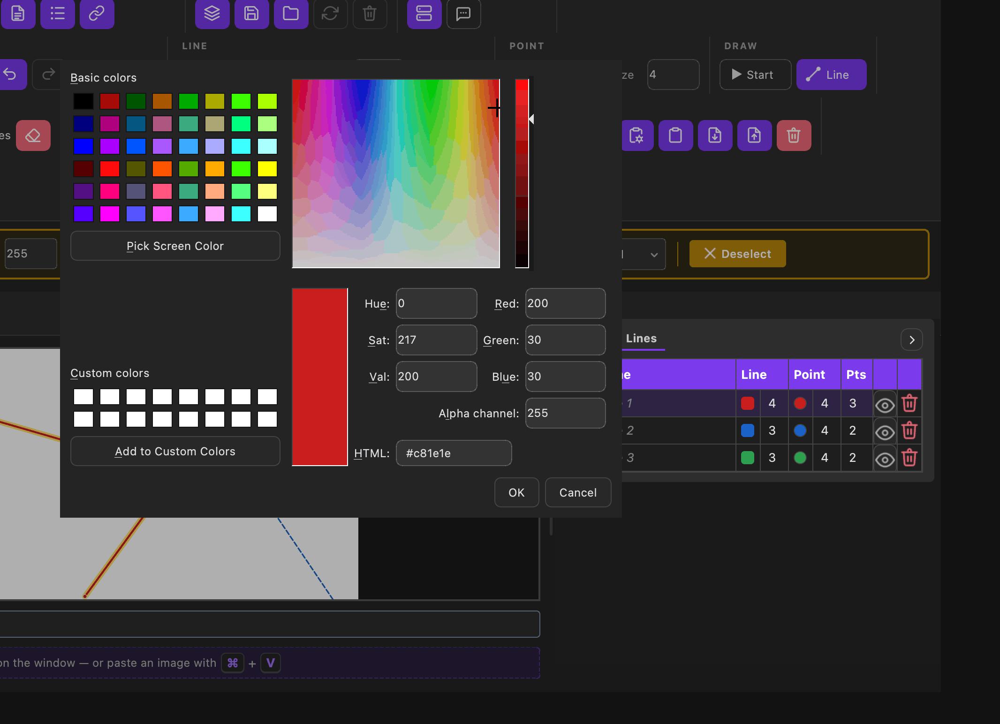

Drag one colour swatch onto another to copy the colour. While you drag, every swatch that can
take the colour glows, and the one you drop on uses it as if you had picked it yourself. Below,
the line colour is dropped on the tint swatch, and the tinted picture takes it.

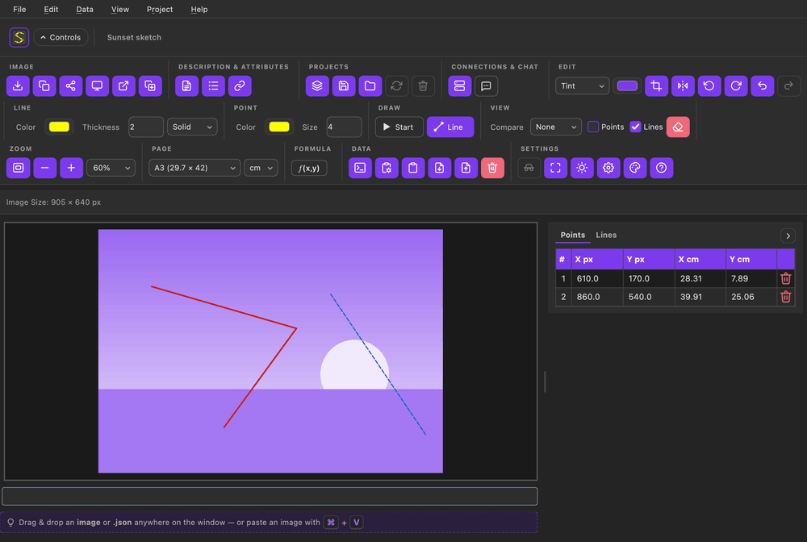

## Filter, crop, flip and rotate

The filter list in the **Edit** section holds **B&W**, **Sepia**, **Invert**, **Contour** and
**Tint**, the swatch beside it sets the tint's colour, and `Alt+B` steps through them
(`Alt+Shift+B` back).

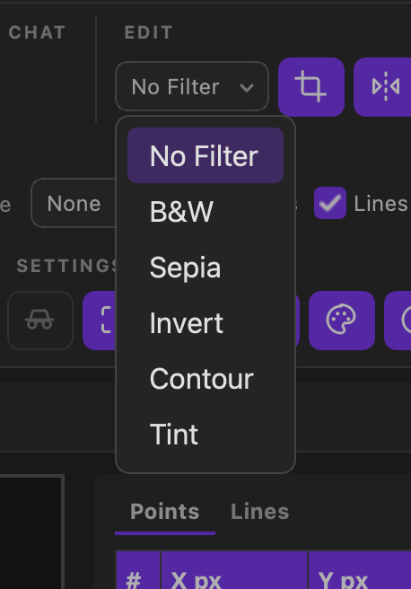

**File ▸ Crop Image…** (`Ctrl+Shift+X`) opens a crop box locked to the page's shape: **Album** /
**Portrait** flips it, **Apply Crop** keeps it. The dialog always fits on the screen, and resizing
it re-fits the picture. **File ▸ Flip Horizontally** (`Alt+Shift+F`) mirrors the picture left to
right, and **Rotate Left** (`Alt+R`) and **Rotate Right** (`Alt+Shift+R`) turn it by quarter
turns. The lines and the crop follow both, the zoom and the spot you were looking at stay put,
and **Edit ▸ Undo** (`Ctrl+Z`) and **Redo** (`Ctrl+Shift+Z`) cover all of it.

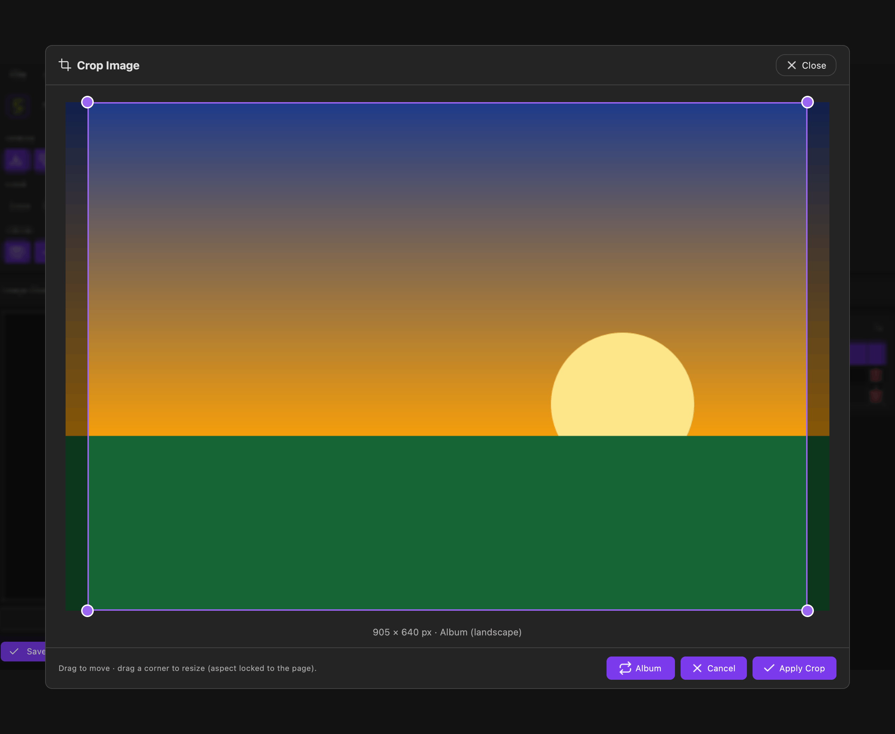

## Compare before and after

**Compare** in the **View** section shows the picture as it was: **Original**, or a split —
**Split ↔** or **Split ↕** — with a divider you drag; **View ▸ Compare** has the same choices.
`Alt+O` steps through them; hold `Alt+Shift+O` to see the original until you let go.

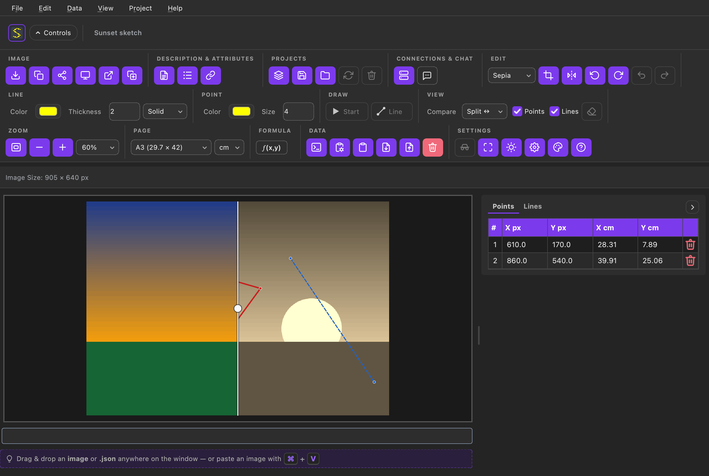

## Zoom, pan and page size

The **Zoom** section fits the picture to the window (`Alt+0`), steps out and in (`Alt+↓`,
`Alt+↑`) and takes a percentage. Ctrl+wheel zooms toward the pointer (Shift for bigger steps),
Shift+drag zooms to a rectangle, and Alt+drag on an empty spot, a middle-button drag or the
arrow keys move around.

**Page** sets the page the picture is measured against — an ISO A, B or C size, or **Custom** —
and the units, cm or in, the **Points** tab shows. The crop box and a blank page take the page's
shape. **𝑓(x,y)** turns on formulas that transform those page coordinates.

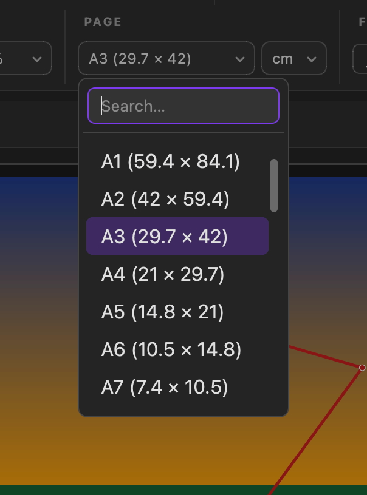

## The canvas menu

Right-click the picture (or `Shift+F10`) for drawing, view, style and filter rows, **Image /
Layout** — copying, downloading and sharing the image, and its layout as JSON — **Make a copy**,
and the **Assistant** and **Stencil Script**, which open right beside the menu.
**Transformation** holds the 𝑓(x,y) formulas.

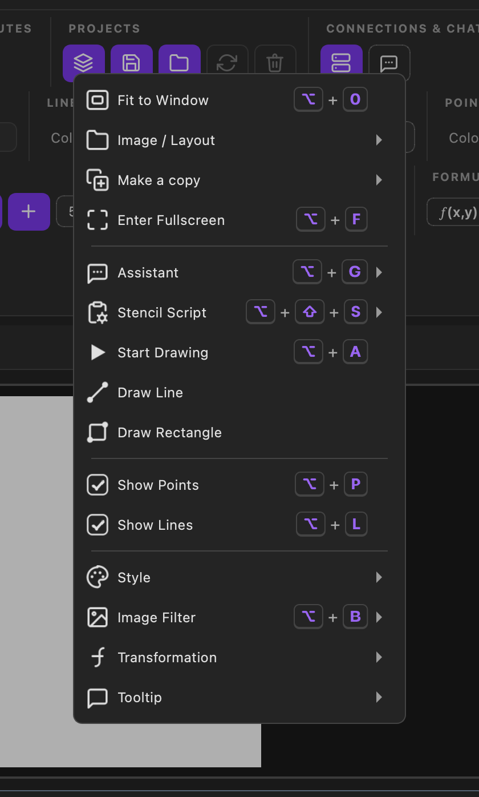

**Make a copy** copies the open project: the picture alone, the picture with its lines and
layout, or the whole project with its colour, keywords, description and chat.

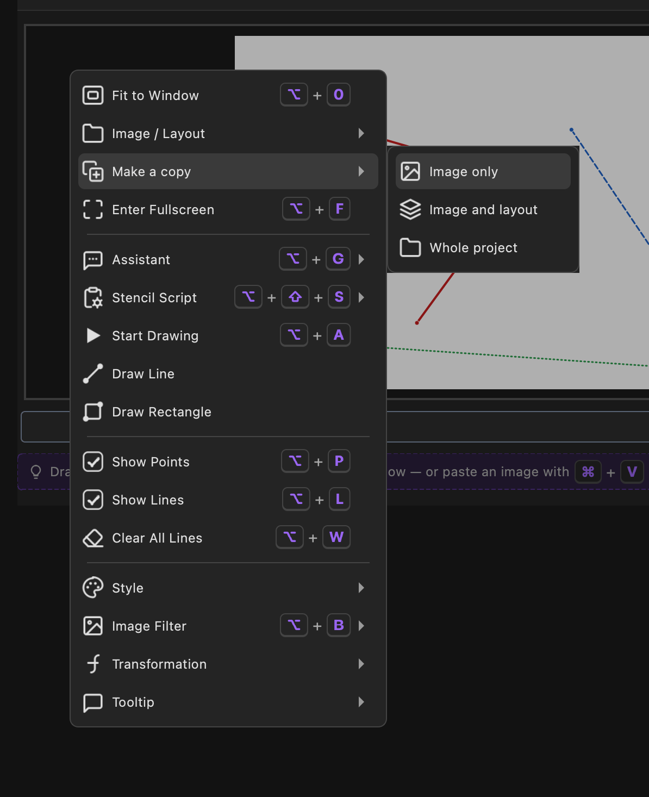

**Stencil Script** opens a script editor beside the menu, for a recipe run without leaving the
picture.

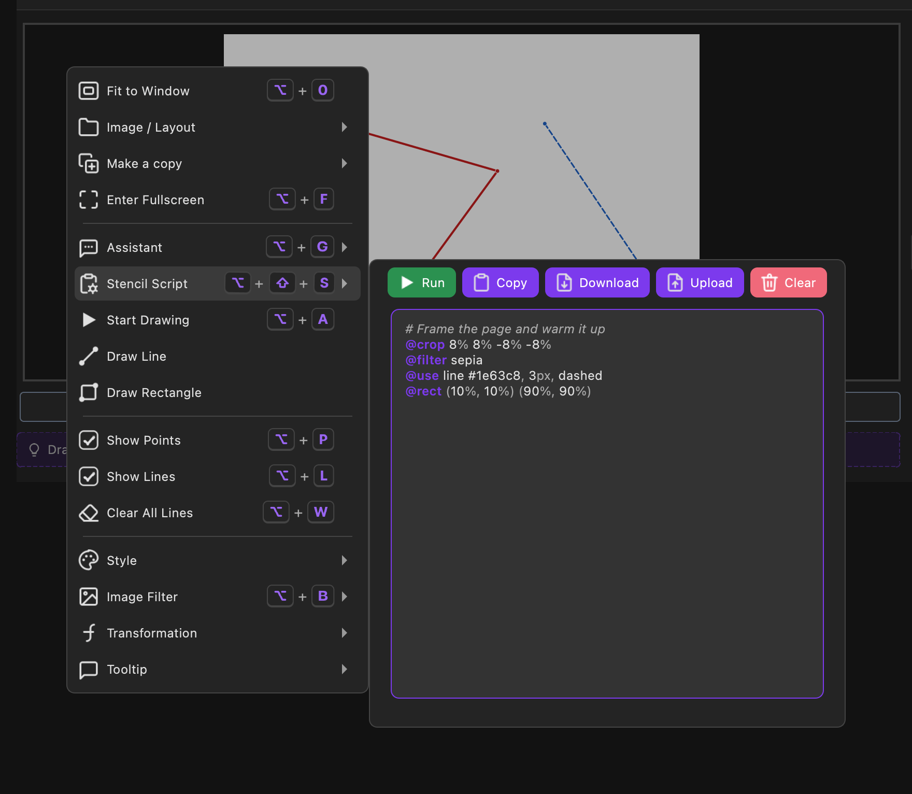

## Drag a toolbar icon

An icon dragged off the toolbar carries its action to wherever you let go. Let go back on the
icon, or press Escape, and nothing changes.

An icon that opens a dialog — Open Image, Crop, Projects, Servers, the description, keyword and
link dialogs, Open In…, Script, Visuals & Settings, Keyboard Shortcuts and Help — opens it with
its top-left corner where you let go. The chat icon raises the dock zones: drop in one to dock
the chat on that side, anywhere else to float it there.

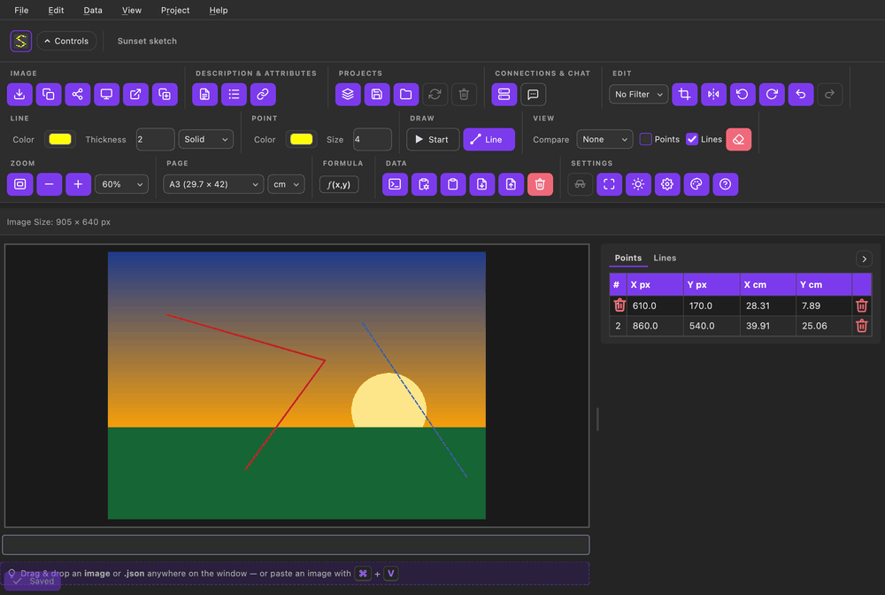

Rotate, flip and **Clear All Lines** (the eraser, which then asks nothing) act only when dropped
on the picture. Drag **+** or **−** and the zoom follows the pointer: the farther from the button,
the closer in or farther out. Drag **Fit to Window** and the two become targets: hold it over **+**
to step in, over **−** to step out, and drop it back on its button to return to where you started.

### Clean view from the logo

Drag the logo onto the picture to see it bare: no filter, lines, points or compare split while
the logo is over it. Drop it there to keep that clean view; the toolbar's filter and view
controls follow. Drop it on a line — on the canvas, its **Lines** row or the selected-line bar —
and that line takes the toolbar's style; drop it on a control that has a default and the control
goes back to it. Anywhere else, nothing changes.

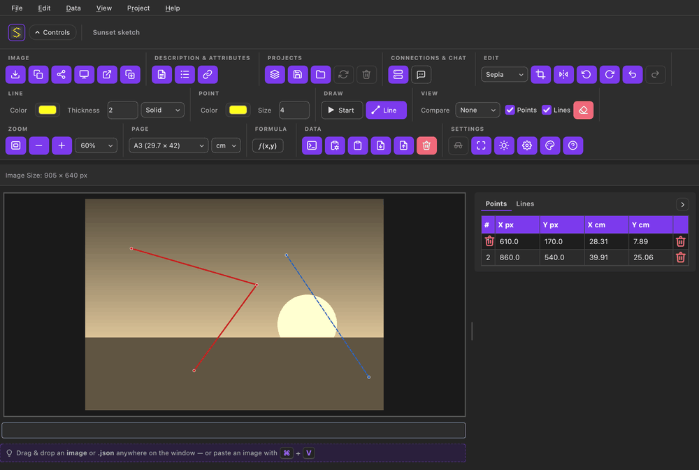

## Change the look

**View ▸ Visuals & Settings…** (`Alt+V`) holds the accent colour, light/dark/system appearance,
the interface motion (Dust, Water, Fire, Sliding, None), how fast it plays (**Animation speed**,
0.1 to 1), how fast the console types (**Console text speed**), notifications, the drawing
defaults and the app's preferences. Double-click a row's title to put that setting back to its
default.

Clicking the logo cycles the accent; right-click it for the whole list.

| Visuals & Settings | The logo's accent list |
|---|---|
| 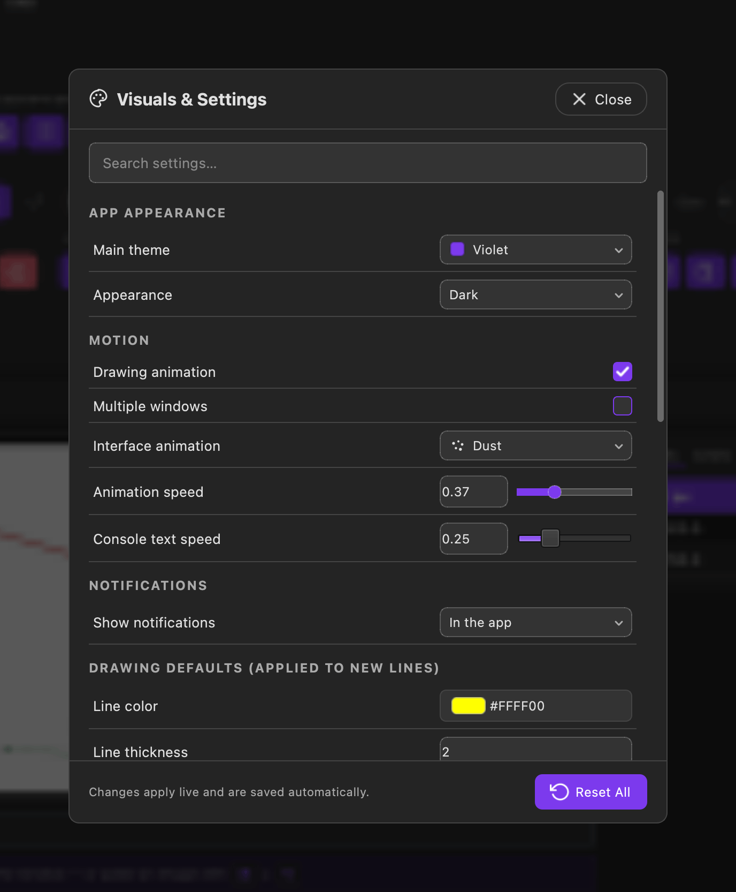 | 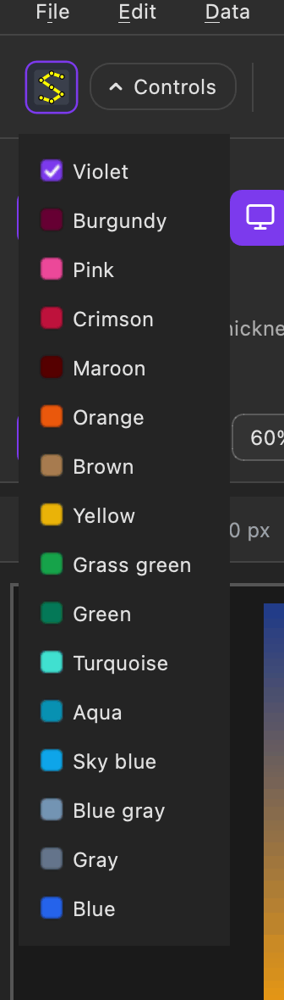 |

With **Multiple windows** on, dialogs like Settings or Projects open side by side and stay open:
nothing behind them dims, and a click outside closes none of them.

The theme switch sweeps the new palette in from the button you pressed:

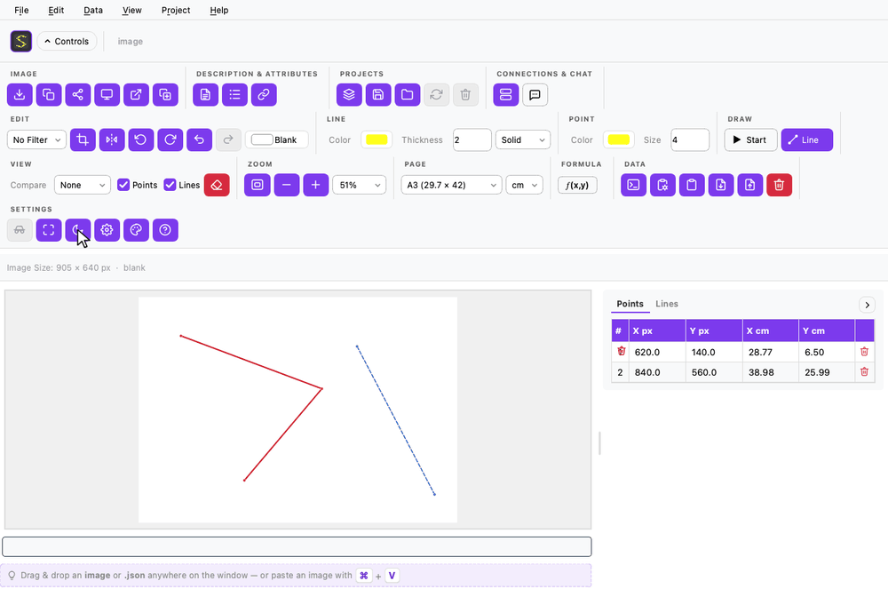

Drag the theme switch instead of clicking it and a round lens follows the pointer, showing the
window in the other theme; over the picture it shows the colours inverted. Let go and nothing
changes.

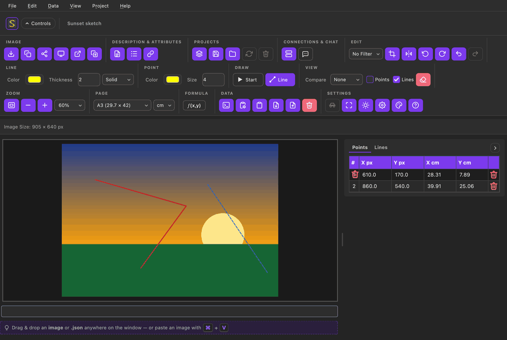

## Work in fullscreen

**View ▸ Enter Fullscreen** (`Alt+F`) hides the toolbar so the picture fills the screen; it
slides back in when the pointer touches the top edge, and leaves again when the pointer moves
away.

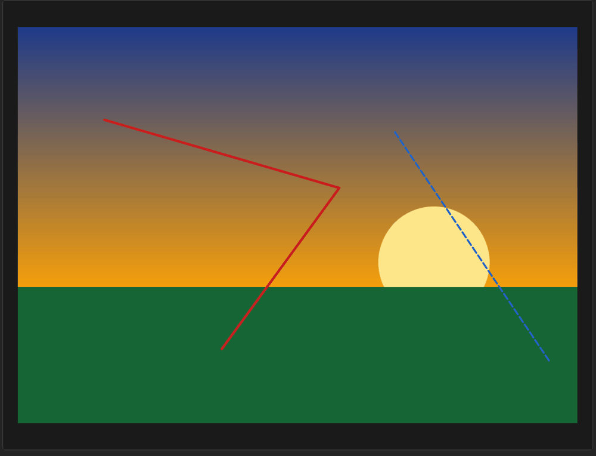

## Ask the assistant

**View ▸ AI Assistant** (`Alt+G`) opens the chat dock. Describe the edit, and the model answers
with a plan that runs through the same operations as the toolbar; other takes come back as cards
you can download or open. The dock sits on any edge or floats. Below, a turn asked to frame the S
with a dashed red rectangle and warm the picture with sepia:

| Docked | Floating |
|---|---|
| 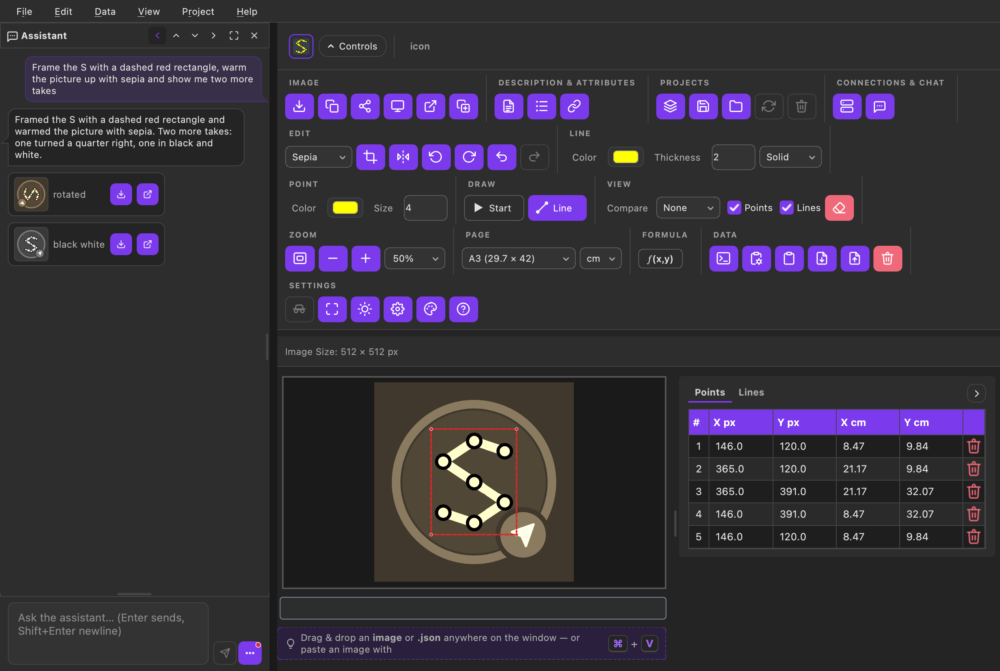 | 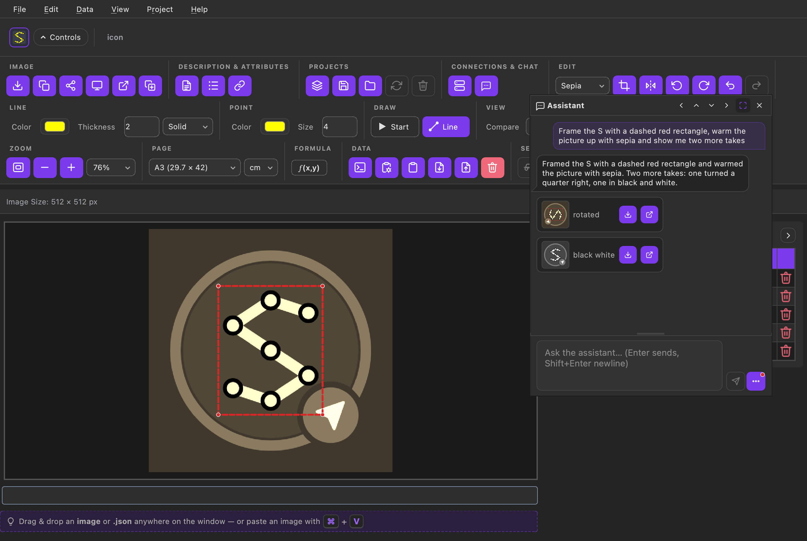 |

**View ▸ AI Assistant Settings…** (`Alt+Shift+G`) points it at a model: **Ollama**, an **OpenAI
API** server such as LM Studio or vLLM, the **Anthropic API (Claude)** with your own key — held in
memory only, never saved — or a **Stencil server** that proxies its own key. **Save chats
with projects** keeps the conversation with the project.

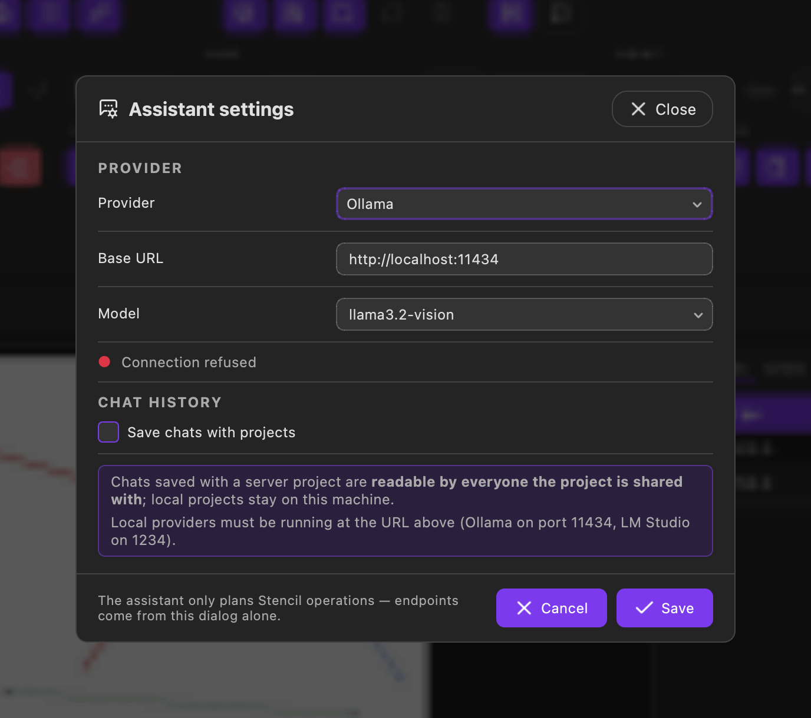

## Run a script

**Data ▸ Stencil Script…** (`Alt+Shift+S`) takes a `.stc` recipe and colours it as you type;
**Run** (`Ctrl+Enter`) runs it and names any error by its line. Drop a `.stc` file on the window
to run it at once.

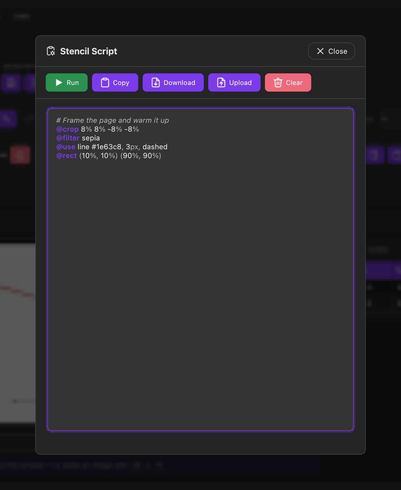

A script can also arrive by a `stencil://` link, from the browser app or from VS Code. It opens
in the Script dialog, highlighted and ready to edit; nothing runs until you press **Run**.

## Save and export

**Download** (`Ctrl+Shift+D`) saves the picture — PNG, JPG, WebP or BMP, as the file name says —
and **Copy** (`Ctrl+C`) puts it on the clipboard. Right-click or double-click either for the
choices: **Current** (with the filter, lines and points), **Original** (with neither), **Filter
Only** (no lines or points) and, while a split compare is up, **With Compare**. **Data ▸ Copy
Image** and **Download Image** hold the same choices; **Share Image…** (`Ctrl+Alt+S`) hands the
picture to the system's share sheet where there is one.

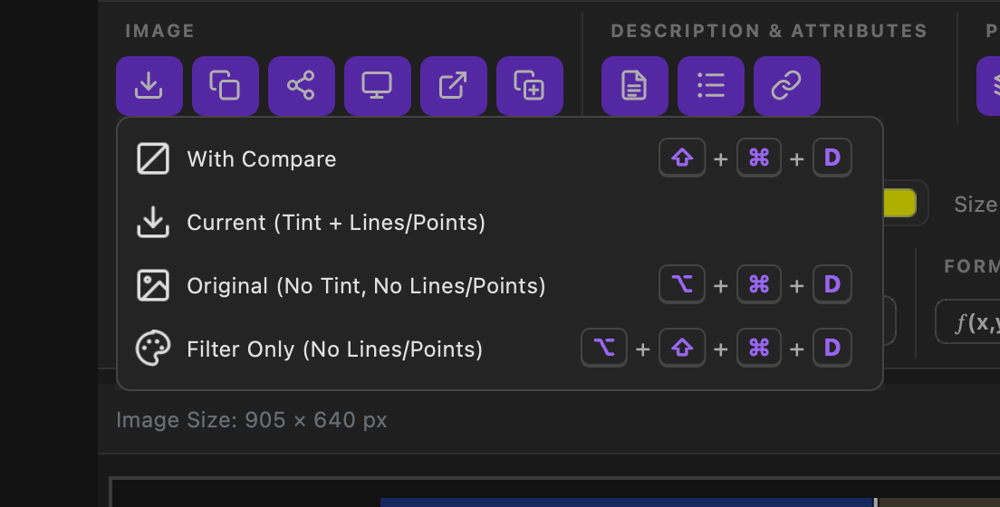

**Data ▸ Save Project As… (.stencil)** (`Ctrl+Shift+S`) writes the picture, its lines and its
settings to one `.stencil` file, and **Open Project… (.stencil)** (`Ctrl+Shift+F`) reads one
back. Once a project is tied to a file, **Live Sync with File** (`Ctrl+Shift+Y`) keeps the two in
step, saving each edit and picking up changes made to the file. **Export Layout JSON…** and
**Import Layout JSON…** save and load the layout alone, **Copy Layout JSON** and **Paste Layout
JSON** do it through the clipboard, and `Ctrl+V` pastes a picture or a layout.

## Projects

Every editor auto-saves into a local project. **Project ▸ Projects…** (`Ctrl+Shift+P`) lists
them, the one you opened most recently first (or by name, by last edit, local or server first, or
in your own order), and searches their names and keywords. A project you leave unopened expires
after 7 days unless you give it longer; one kept forever says **never expires**.

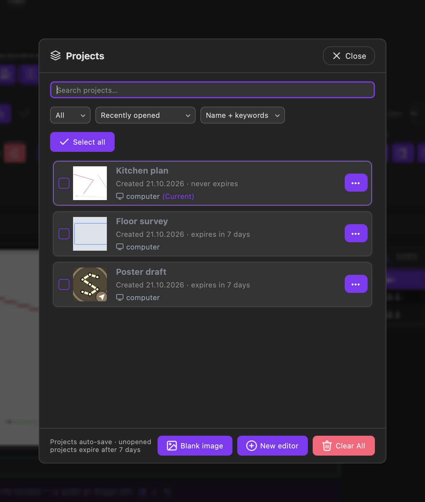

A row's **⋯** menu opens, renames, colours, describes and expires it, and has **Make a copy**
right after **Open in another app**; the toolbar's Image section has the same choice behind its
copy button. Pick **Image only**, **Image and layout** or **Whole project**, then answer the
question: **Just copy** adds the copy to the list and leaves everything else open, **Open**
switches to it, **Open in new window** opens it beside this one. **Open in incognito** opens the
copy without ever saving it. Copies are named after the project — `Kitchen plan-copy`, then
`Kitchen plan-copy(1)`, and so on. For a project that lives on a server, the copy is made on that
server unless **Make a local copy** is ticked, and only a local copy can open incognito.

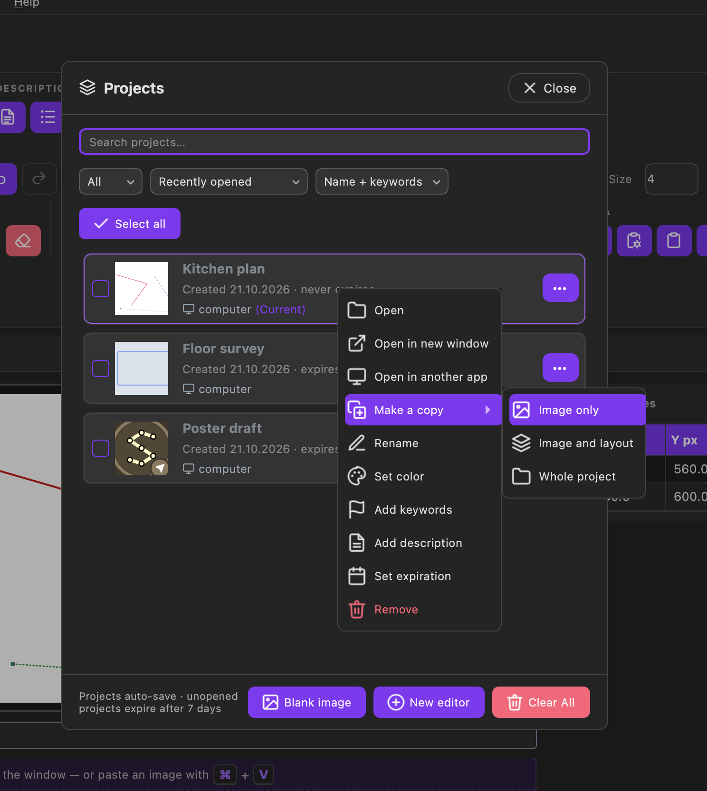

| A local project | A server project |
|---|---|
| 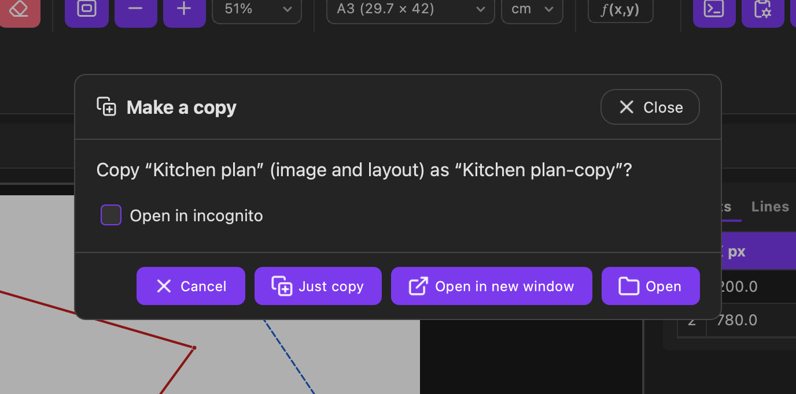 | 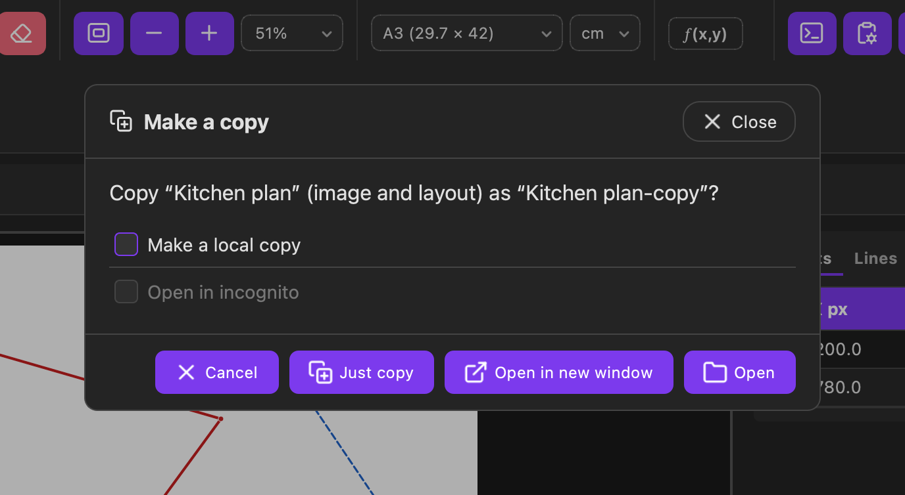 |

Drag a project row out of the list and the window behind it offers **Open here**, **Open in a new
window** and **Remove**; the zone under the pointer lights up and the drop decides which one runs.

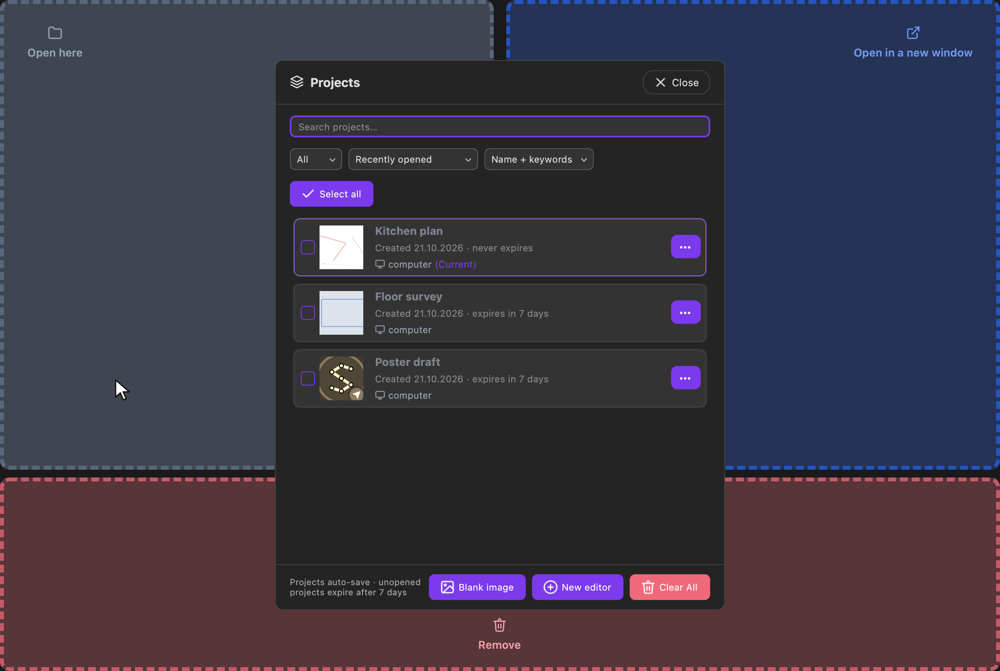

## Work together on a server

**Project ▸ Servers…** (`Ctrl+Shift+K`) connects to a Stencil collaboration server with its URL
and a token. **Auto-connect on open** and **Sync changes to server** are on by default. Connected
with the server's admin token, a row also offers an invite link: it mints a fresh token and copies
a link that connects someone else.

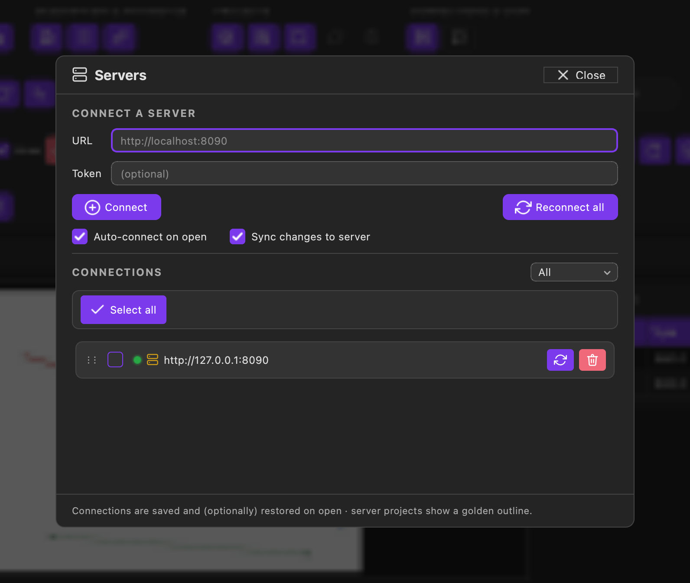

A project moves to the server from its row's **⋯** menu (**Move to server** or **Copy to
server**), or starts there through **Save to** in the Open Image dialog. Server projects wear a
gold outline in **Projects**, with the server's address under the name, and anyone connected can
open them.

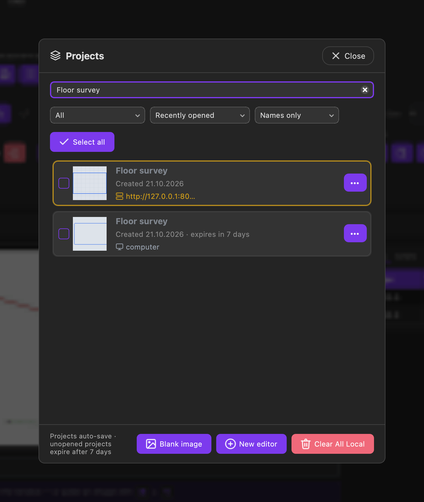

With **Sync changes to server** on, your edits to a server project are saved there as you make
them, and when someone else changes a server project you have open, it reloads with their changes.

## Describe the project

**Project ▸ Project Description…** (`Alt+Shift+D`), **Project Keywords…** (`Alt+Shift+K`) and
**Image Links…** (`Ctrl+Shift+L`) keep a project's description, its keywords (what the Projects
search matches) and the image's source and resource links.

| Description | Keywords | Image links |
|---|---|---|
| 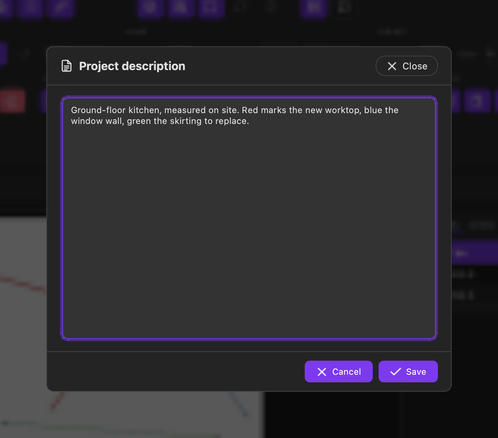 | 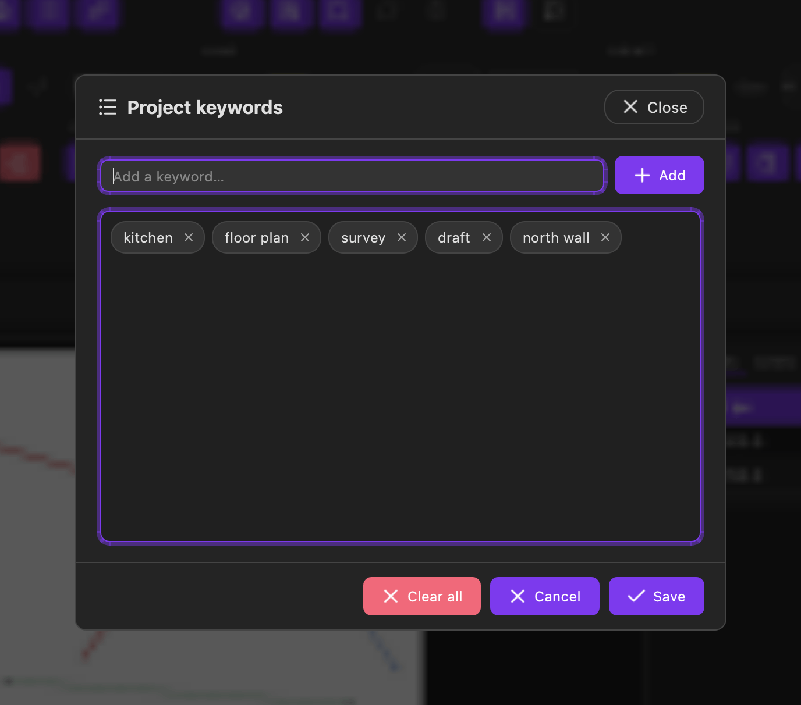 | 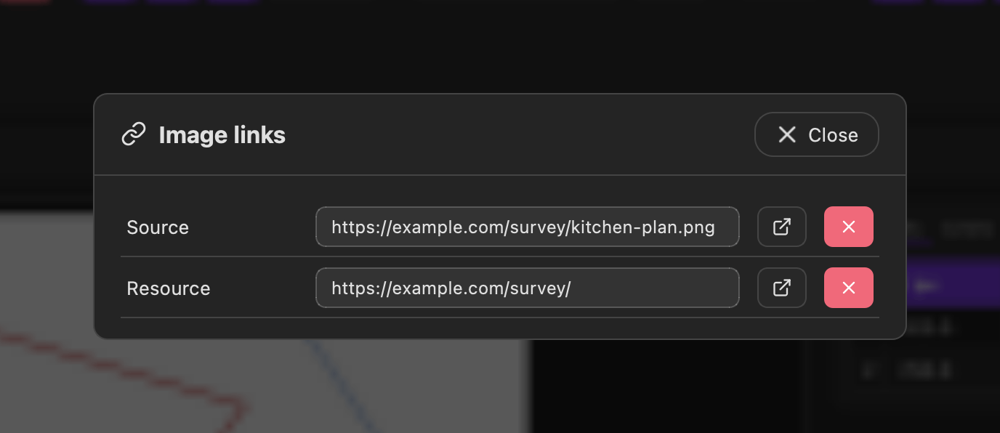 |

## Hand a project to another app

**Project ▸ Open In…** (`Ctrl+Shift+E`) sends the current project to the browser app — and, when
a Telegram bot is set up and the project lives on a server, to the bot. A local project travels
inline, picture and layout together, with no server involved.

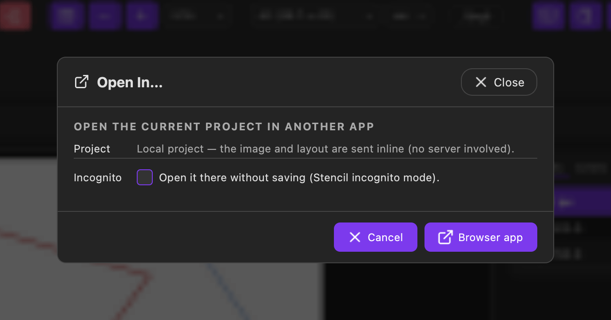

## Type commands in the console

**Data ▸ Console…** (`Alt+Shift+T`, the first button of the Data section) opens a console beside
the editor. It blocks nothing: type `/help` for the commands, `/crop x1=10% x2=90%`, `/rotate 1`,
`/filter bw`, `/theme dark`, `/connect <url>` or `/browser`, and the answer types in at the
**Console text speed**.

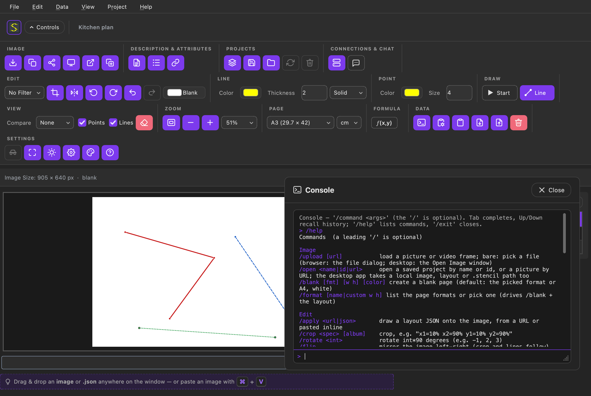

## Shortcuts and help

**Help ▸ Keyboard Shortcuts…** (`Alt+K`) rebinds the actions: double-click a shortcut and press
the new combination. Most take effect at once; a new key for the assistant, the Script dialog, the
compare cycle or Open In… takes effect the next time the app starts, and a few keys are fixed,
such as pressing `~` twice and `Alt+N`. **Help ▸ Controls & Shortcuts Info** (`Alt+H`) lists the
mouse and keyboard gestures.

| Shortcuts | Help |
|---|---|
| 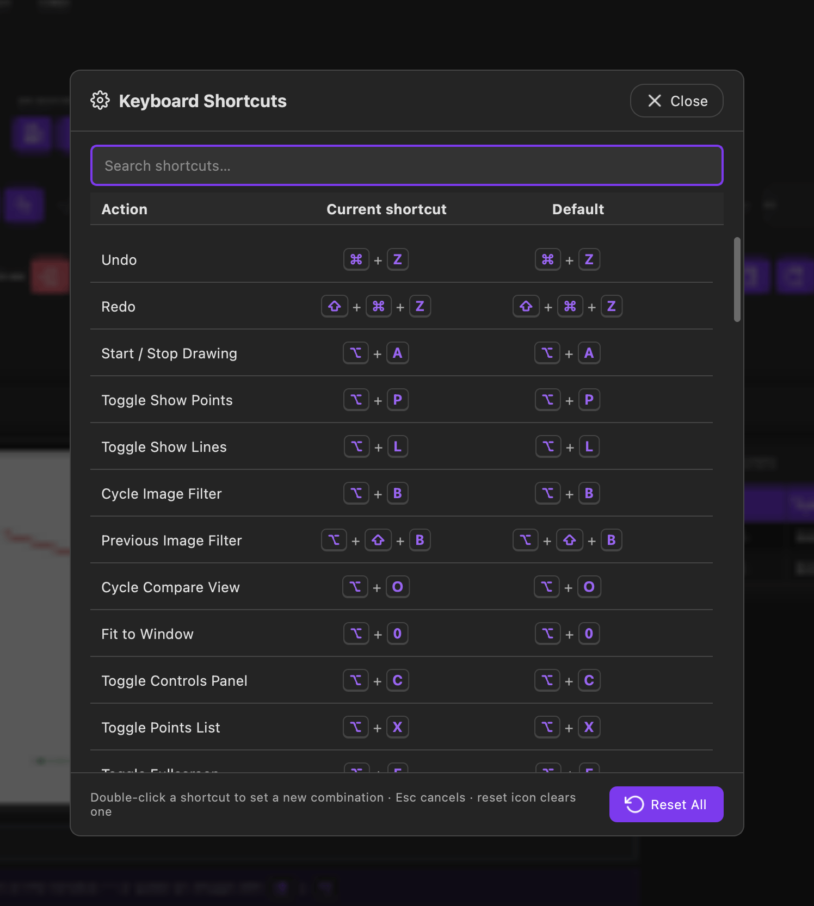 | 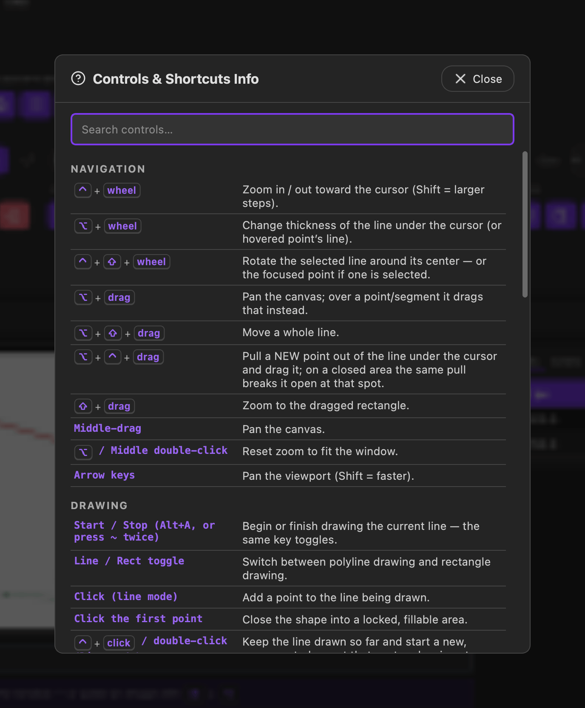 |
