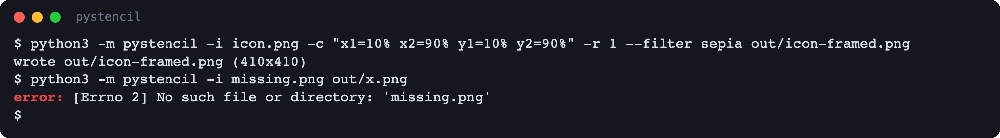
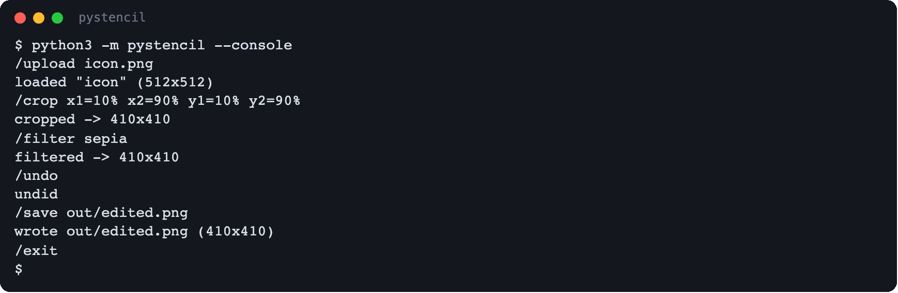
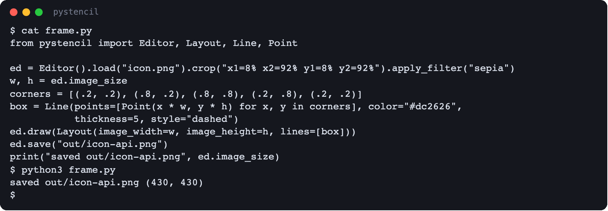
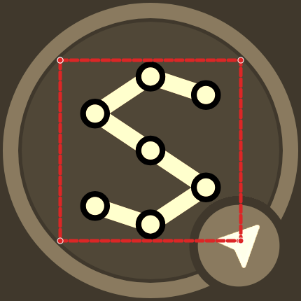
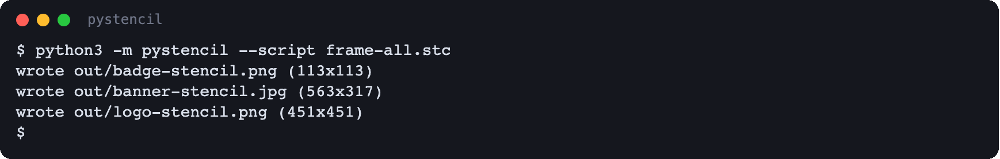
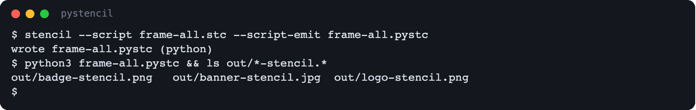
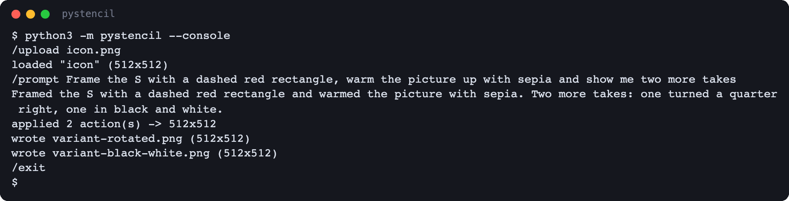
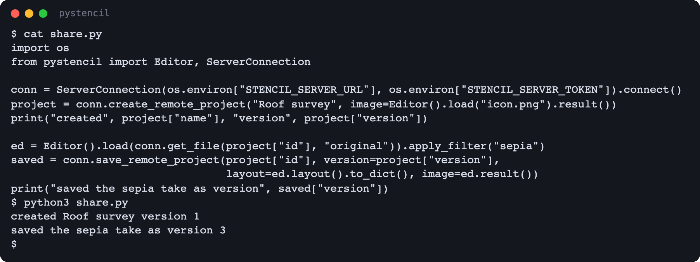

# pystencil — use cases

The Python package: the same editing core as the CLI, from a terminal or from your own Python.
Build it from [`pystencil/README.md`](../../../pystencil/README.md).

## One-shot edits

`python3 -m pystencil` (installed as `stencil-py`) takes the CLI's editing flags — a source, the
edits, the output path — and answers with `wrote <path> (<width>x<height>)`, or `error:` and
what went wrong.

## The console

`python3 -m pystencil --console` reads the CLI console's `/commands` a line at a time, without
the full screen: `/upload`, `/crop`, `/filter`, `/undo`, `/save` and the rest, each answered as
it runs.

## Edit from Python

`Editor` chains the same edits: load a path, a URL or bytes, crop, filter, draw a `Layout` of
`Line`s, save. `image_size` reads the picture's size at any point, so a drawing can be measured
against it.

## Run a script over a folder

`--script` runs a `.stc` file the way the CLI does — a `@source` folder edits every picture in
it that pystencil reads (PNG, BMP, JPEG).

## Run an emitted `.pystc`

The CLI's `--script-emit` (or VS Code's **Emit script as…**) turns a `.stc` into a Python file
over pystencil. It runs on pystencil alone, without the CLI, and writes its pictures without
printing.

## Ask the assistant

With `STENCIL_LLM_*` pointing at a model, the console's `/prompt` asks it for an edit: the plan
runs on the loaded picture, and each variant it asks for is written as `variant-<label>.png`.
From Python, `Editor.prompt` does the same and returns the variants.

## Share through a server

`ServerConnection` connects to a collaboration server with a token; `create_remote_project`
uploads a picture as a new project, `get_file` reads one of its files back, and
`save_remote_project` writes an edit under the version it was made against, so a newer save by
someone else is never overwritten.

