# VS Code extension — use cases

Editing `.stc` scripts, `.stcjs` and `.pystc` files in VS Code, and running them — through
the CLI, in the browser app, or on Python. Install it from
[`vscode-extension/README.md`](../../../vscode-extension/README.md).

## Open a script

Every file type is marked in the explorer: a script, its JavaScript and Python flavours, and
a saved project. The extension works in a trusted folder; in Restricted Mode it stays off.

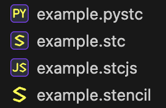

A `.stc` file's every word is coloured by the statement it sits in: directives, lengths and
units, colour names, filter modes, stroke styles. **Stencil: Configure highlight colours** sets
the colour of each kind of word.

| Light | Dark |
|---|---|
| 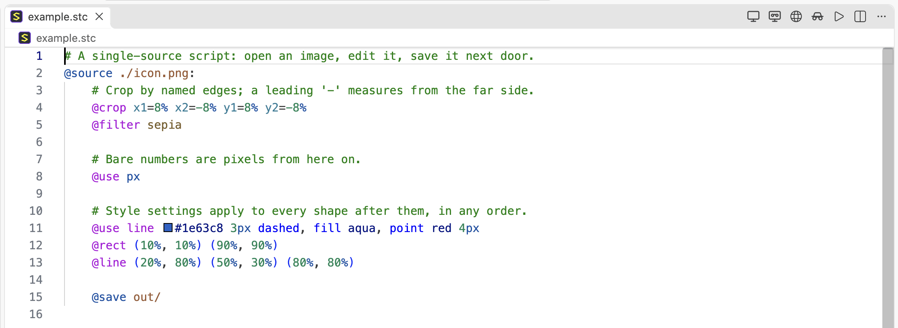 | 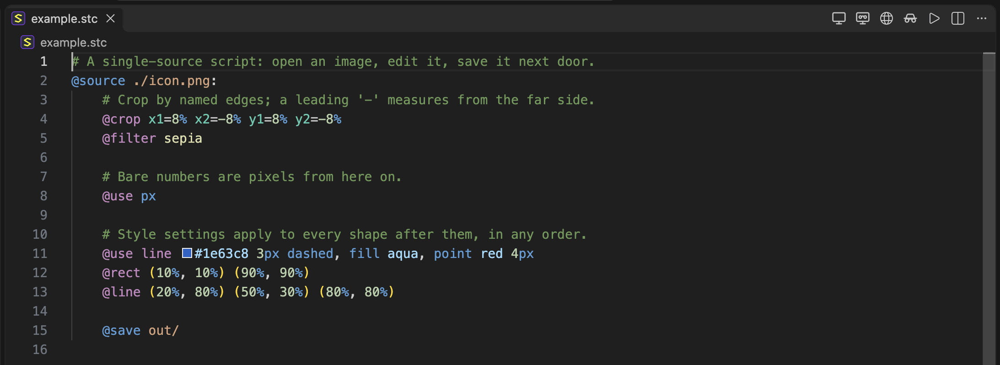 |

## Complete as you type

Type `@` for the directives, each with what it does; inside a statement the suggestions are
what is legal there: filter modes, stroke styles, crop edges, colour names, the templates the
file defines, and units as whole replacements of the length being typed.

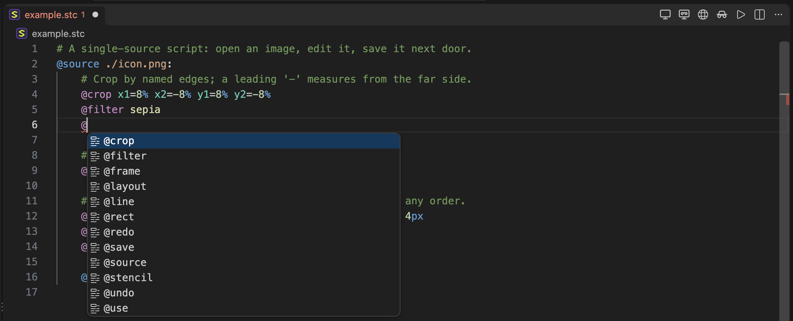

The list narrows as you type, Enter accepts, and the next statement offers its own words —
here a filter mode, then a colour name with its swatch.

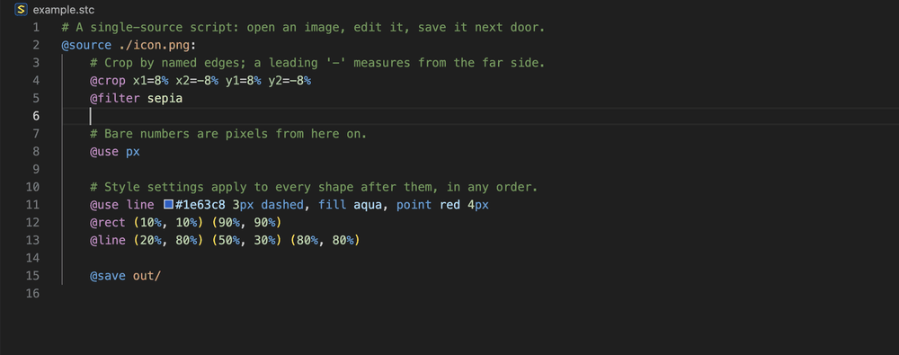

## Look a word up

Hover a directive or keyword for its meaning, argument grammar and an example.

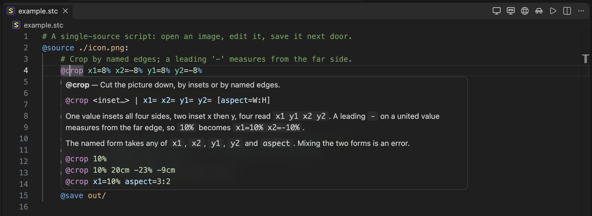

## See errors as you write

A mistake is underlined while typing and listed in the Problems panel with its code. When the
CLI is found and `stencil.checkOnSave` is on, a saved file is also checked by the compiled
engine that runs it. A script with any error runs nothing.

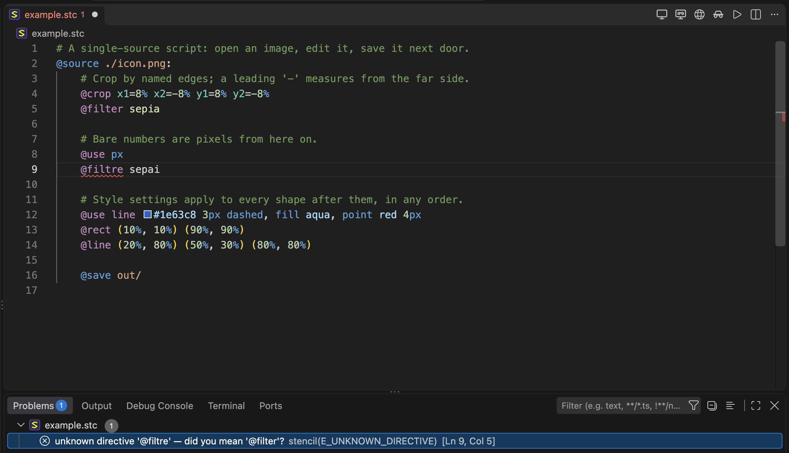

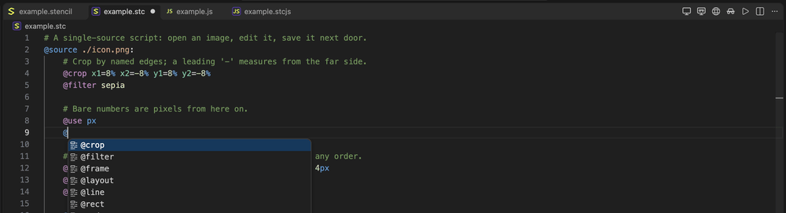

## Point it at the CLI

The run and check commands drive the Stencil CLI. Set `stencil.cliPath` to its binary, or leave
it empty for `STENCIL_CLI`, then `stencil` on the `PATH`; a relative path is refused.

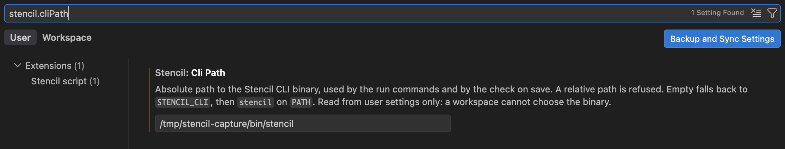

Without one, a run stops and names the setting, and a saved file is checked by the editor's
own parser instead.

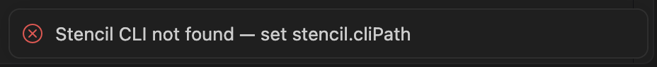

## Run it

**Stencil: Run script** (the ▷ button, `Cmd+Alt+R` / `Ctrl+Alt+R`) saves the file and runs
it through the CLI in a terminal named *Stencil*, from the script's own folder so relative
sources resolve.

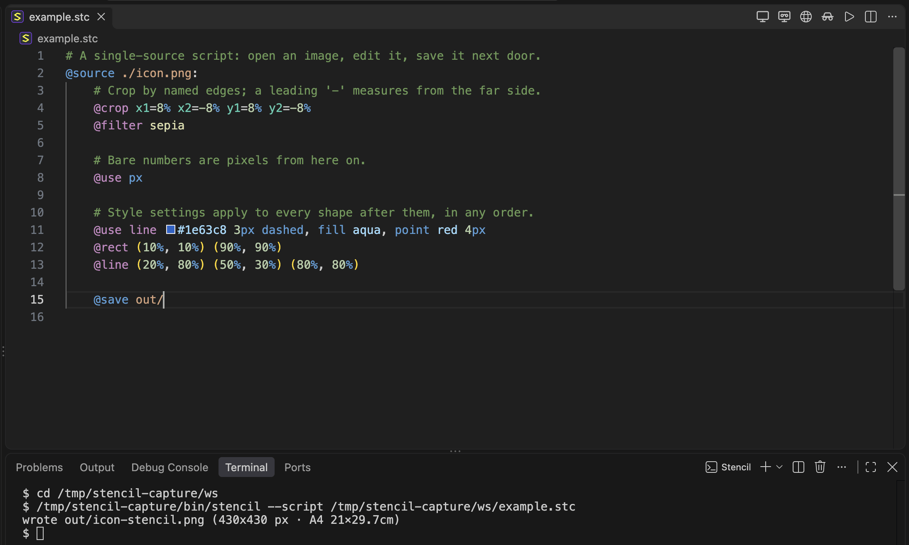

**Stencil: Run script on an image…** asks for a picture and runs the script on it — the way to
run a script that names no `@source`.

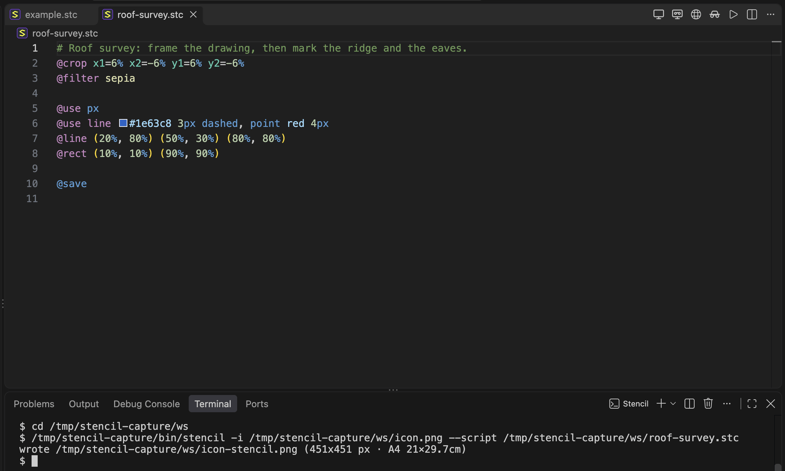

**Stencil: Check script** runs only the CLI's check: each error with its file, line and column,
and nothing written.

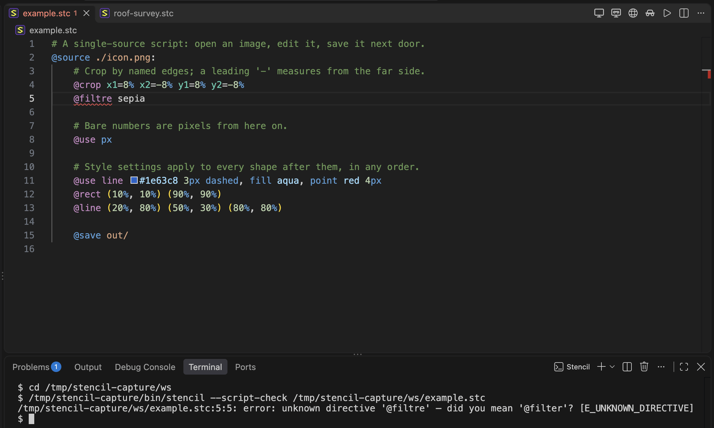

## The buttons on the editor itself

An open `.stc` carries its commands in its own title bar: the **monitor** opens it in the
Stencil desktop app and the monitor wearing incognito glasses does the same in a desktop session
that keeps nothing; the **globe** opens it in Stencil Web and the incognito mark does the same
in a session the app keeps nothing from; **▷** runs it through the CLI. A `.stcjs` shows
**▷ Run in Stencil Web Console** instead, and a `.stencil` project the two web buttons — each
file only offers what applies to it.

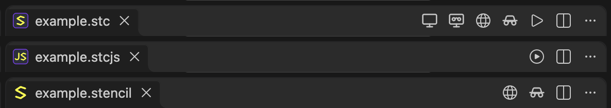

## Send it to the browser

**Stencil: Open in Stencil Web** hands the open script — or a `.stencil` project — to the
browser app. The hand-off rides in the URL fragment, so nothing about it reaches a server. A
script lands in the app's Script window, highlighted and ready to edit, and nothing runs until
you press **Run** there; a project opens as its picture and lines. Its incognito twin does the
same in a session the app keeps nothing from.

A script that names no `@source` acts on whatever is open, so the command asks for a picture to
send along with it. In the browser the script has no filesystem to read either: a `@source`
there must be an `http(s)` URL, and the app says so itself, on the line it happened.

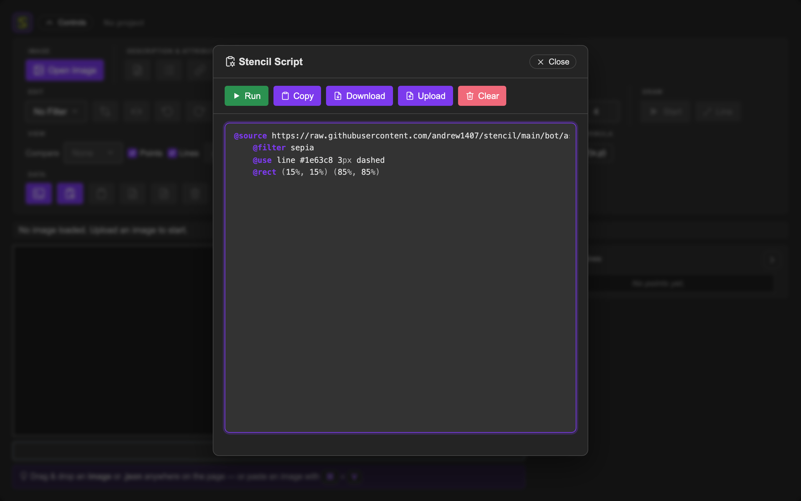

## Send it to the desktop app

**Stencil: Open in Stencil Desktop** (the monitor button) and its incognito twin hand the script
to the desktop app over a `stencil://` link. It opens in the desktop's Script window and runs
only when you press **Run** there; a script that came by link may then open web images only,
never a file on your disk. A script that names no `@source` brings a picture along, as the
browser hand-off does.

## Drive the browser console

**Stencil: Run in Stencil Web Console** (`Cmd+Alt+W` / `Ctrl+Alt+W`, and the ▷ button a
`.stcjs` carries) opens the app — the one `stencil.webUrl` names, or the published one — in
Chrome or Edge under VS Code's own JavaScript debugger, and runs the open file in the page: a
`.stcjs` as it is, a `.stc` through the app's script engine. The same page stays open, so the
file can be run again and again against what is on screen.

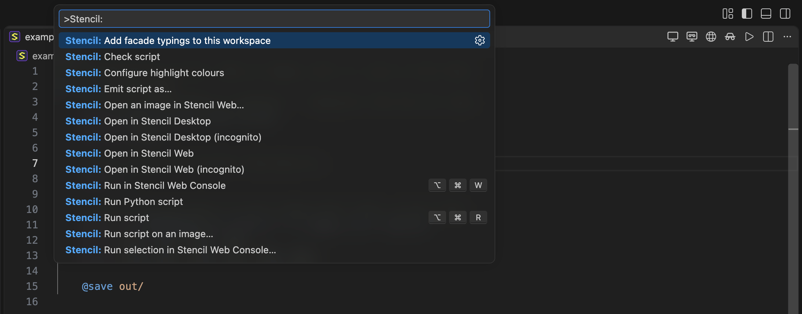

Select a few lines and **Run selection in Stencil Web Console** sends only those. With nothing
selected it asks for the expression instead, so a one-off never needs a file at all.

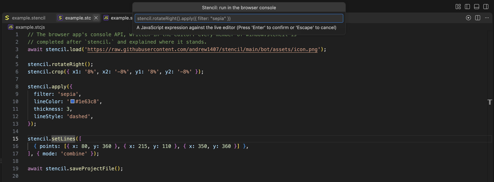

**Stencil: Open an image in Stencil Web…** opens a picture by URL, or from disk. Every command
and its answer land in the **Stencil** output channel.

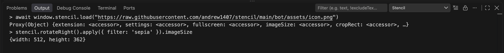

## Write a `.stcjs`

A `.stcjs` is JavaScript against the app's own `window.stencil` API. Every member is offered
after `stencil.`, with what it does beside it.

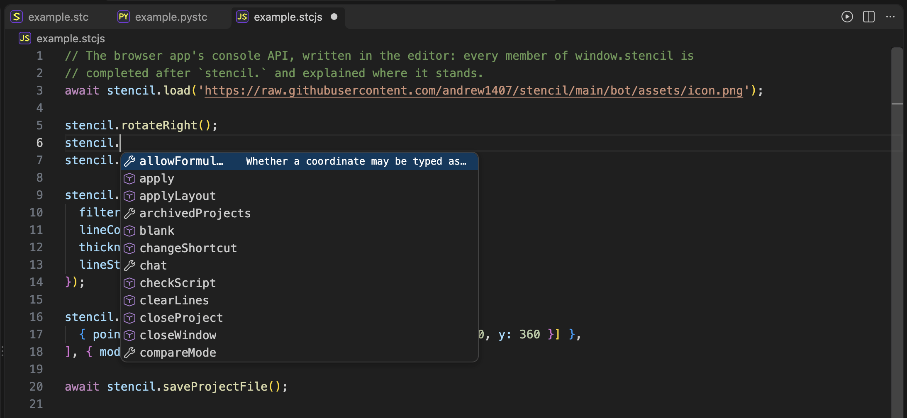

The list narrows as you type, Enter accepts, and the next call offers its own members.

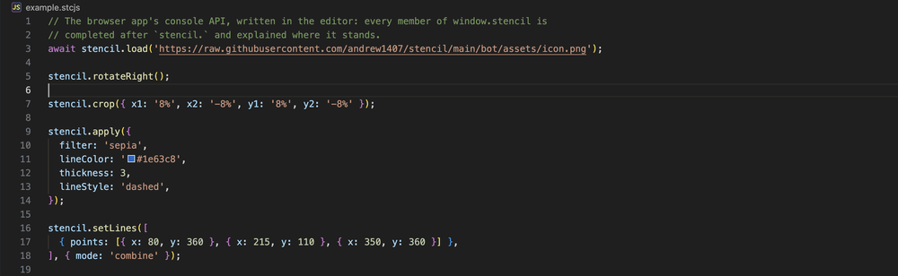

Hover any member for its signature and what it does — and `stencil` itself for what the
facade is, which the editor's own JavaScript service can only call `any`.

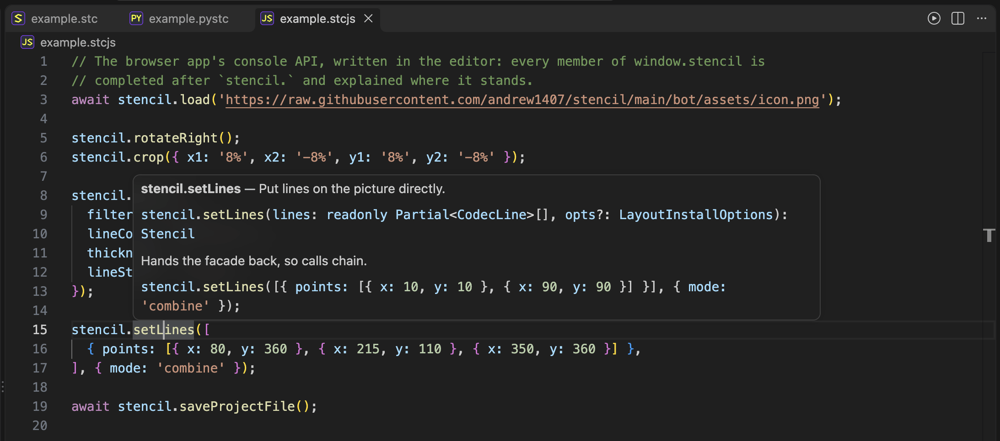

A plain `.js` joins in as soon as it says `// @use stencil` on a comment line of its own —
anywhere in the file, first line or last. The marker is coloured where it stands, so it reads as
the declaration it is, and hovering it explains itself; the same words with code in front of
them are not the marker, and say so instead. A `.stcjs` runs through the
console command — it is JavaScript, and the app itself never evaluates code.

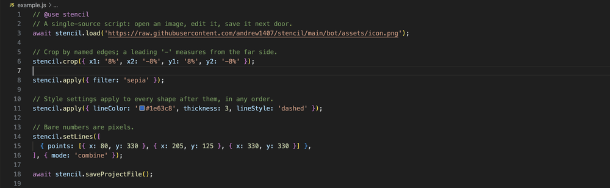

In a `.js` the editor has its own opinion about a global nothing declares, and says `any`
under the explanation. **Stencil: Add facade typings to this workspace** settles it: the types
land beside your code, the editor types `stencil` itself, and one tooltip carries the type,
the prose, the example and a link back to these docs.

## Write it once, take it elsewhere

**Stencil: Emit script as…** turns the open `.stc` into a script for another surface. The
suffix you pick *is* the choice: `.pystc` and `.py` come out as Python over pystencil,
`.stcjs` and `.js` as JavaScript over the browser app's `window.stencil`.

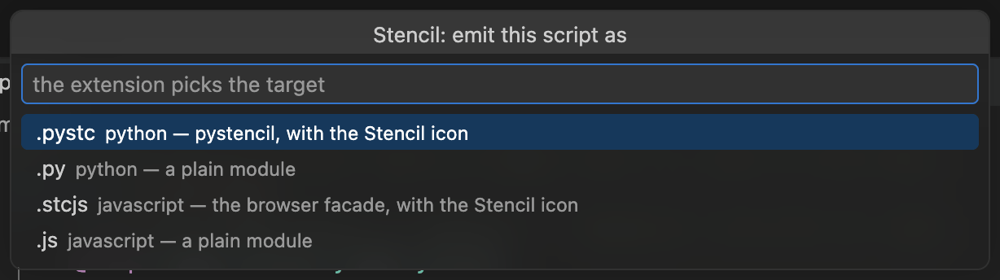

The file lands beside the script under its own name. Lengths like `10%`, the `@source` it
opens and where `@save` writes all come out as the script wrote them, so the emitted file is
as general as the `.stc` was — point it at a different picture and it still means the same
thing.

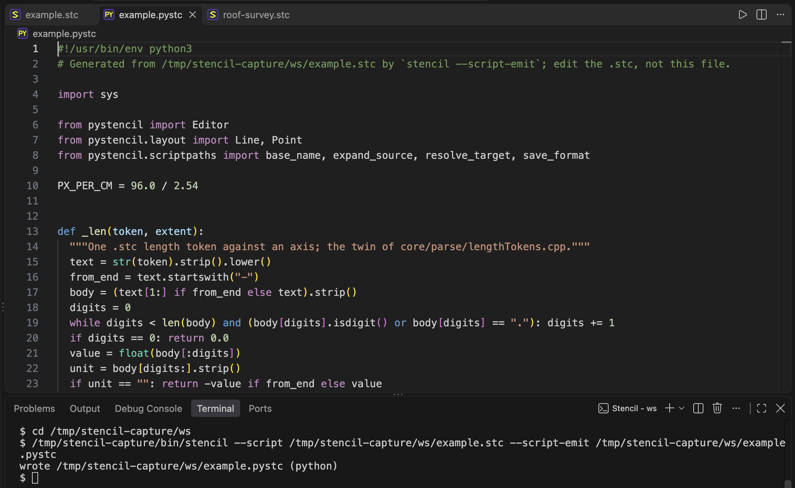

A `.pystc` carries the Stencil icon and its own ▶: **Stencil: Run Python script** runs it on
Python — the interpreter `stencil.pythonPath` names, else `STENCIL_PYTHON`, else `python3` or
`python` on the `PATH` — with no CLI involved, in the same *Stencil* terminal, from the file's
own folder. It writes its pictures without printing a line.

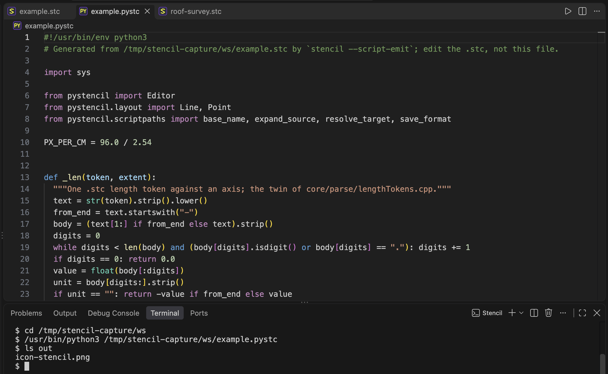
